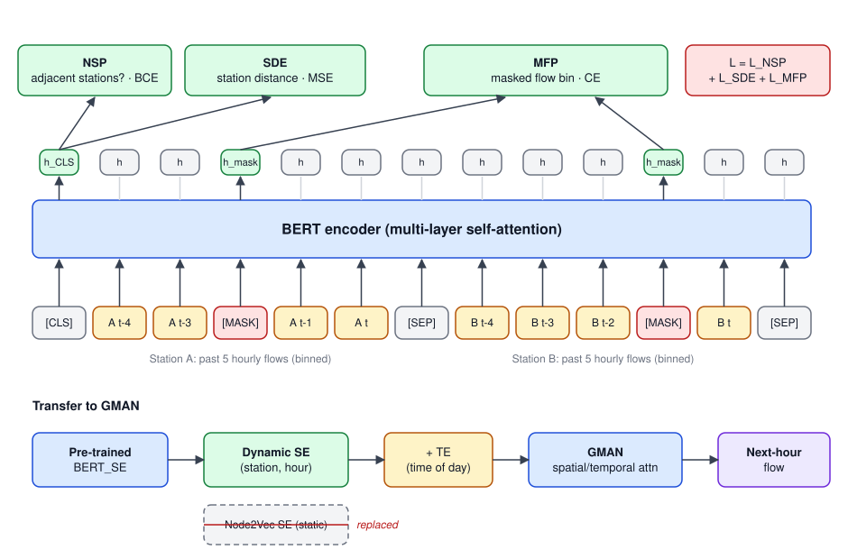

## Paper Info

| Item | Details |
|---|---|
| Venue | 2021 10th International Congress on Advanced Applied Informatics (IIAI-AAI) |
| Authors | **Wei-Yi Chung**, Yen-Nan Ho, Yu-Hsuan Wu, Jheng-Long Wu |
| DOI | [10.1109/IIAI-AAI53430.2021.00070](https://doi.org/10.1109/IIAI-AAI53430.2021.00070) |
| Code | [h30306/A-Dynamic-Embedding-Method-for-Passenger-Flow-Estimation](https://github.com/h30306/A-Dynamic-Embedding-Method-for-Passenger-Flow-Estimation) |
| Slides | [Conference_Howard_20210706.pdf](https://github.com/h30306/A-Dynamic-Embedding-Method-for-Passenger-Flow-Estimation/blob/main/Conference_Howard_20210706.pdf) |
| Award | [Competitive Paper Award](https://github.com/h30306/A-Dynamic-Embedding-Method-for-Passenger-Flow-Estimation/blob/main/Competitive%20Paper%20Award.pdf) |

This was the first paper from our MRT traffic project. As first author I designed the model, ran the experiments, wrote the paper, and presented it in English at the online conference. The extended journal version was later published in Knowledge-Based Systems; see [Dynamic Traffic Network Representation Model]().

## Motivation

MRT passenger flow is usually predicted with time-series models such as LSTM, or with spatio-temporal attention models such as GMAN. GMAN learns a **spatial embedding (SE)** per station with Node2Vec, but that embedding is **static**: a station gets the same vector at peak and off-peak hours, on weekdays and weekends.

Transfer stations and regular stations, peak and off-peak hours, behave very differently, and a static vector cannot express "the state of this station at this time". The idea of this paper is to make the station embedding **dynamic** so it changes with time and with the surrounding state.

## Model Architecture



The method has two stages: pre-train BERT_SE, then transfer its dynamic station embeddings to GMAN.

### Stage 1: BERT_SE Pre-training

**Input**: each training example takes two MRT stations, A and B, with their entry/exit counts for the past 5 hours. Flow is continuous and hard to predict directly, so it is **binned** into classes, turning each hour into a token, like a word. The two sequences are joined in BERT format:

```text
[CLS] A(t-4) A(t-3) A(t-2) A(t-1) A(t) [SEP] B(t-4) B(t-3) B(t-2) B(t-1) B(t) [SEP]
```

Some flow tokens are then randomly masked, as in BERT.

**Three objectives** (hence `BERT_three_loss` in the repo):

| Objective | Output used | Predicts | Loss |
|---|---|---|---|
| NSP | `h_CLS` | BERT's original next sentence prediction | Cross-entropy |
| SDE (Station Distance Estimation) | `h_CLS` | Straight-line distance between A and B, teaching spatial relations | MSE |
| MFP (Masked Flow Prediction) | `h` at masked positions | Which flow bin the masked hour falls in, teaching how flow changes over time | Cross-entropy |

The total loss is the plain sum `L = L_NSP + L_SDE + L_MFP`, optimized with Adam. The MFP head is `Linear → GELU → LayerNorm → Linear`, the same as BERT's MLM head.

Why is the embedding "dynamic"? The input is **a station's flow over a specific time window**, so the same station at peak and off-peak hours produces different sequences and therefore different BERT outputs, while SDE adds spatial information to the same vector.

### Stage 2: Transfer to GMAN

GMAN's spatio-temporal embedding is STE = SE (spatial) + TE (temporal), where SE is a fixed Node2Vec vector learned on the network graph. This paper **replaces SE with the BERT_SE output for the current flow**, keeps TE and the rest of GMAN unchanged, and trains GMAN to predict next-hour flow.

## Setup and Results

- Data: hourly entry/exit counts of the Taipei MRT from January 2017 to March 2019; 10 transfer and 10 non-transfer stations (20 in total); counts are log-normalized to reduce scale differences between stations.
- GMAN with dynamic embeddings beats the static-embedding version overall, with **the largest gains at transfer stations**, showing that the dynamic embedding captures how transfer-station flow varies over the day.
- Multi-objective pre-training gives embeddings that capture more aspects of traffic than a single objective.

## Code and Resources

The GitHub repo contains:

- `Project/data/`: station info, distance matrix, and sample 2019 flow data
- `Project/model/Data_preparing_threeloss.py`: builds the pre-training data
- `Project/model/BERT_three_loss/`: BERT_SE pre-training (`run_train.sh`) and embedding export (`predict_embeddings.py`)
- The downstream predictor reuses [GMAN](https://github.com/zhengchuanpan/GMAN) with SE swapped for the BERT output

My local archive also keeps every submission draft (`BERTSE_2021xxxx`), a Chinese draft, the talk script, and the acceptance notice.
