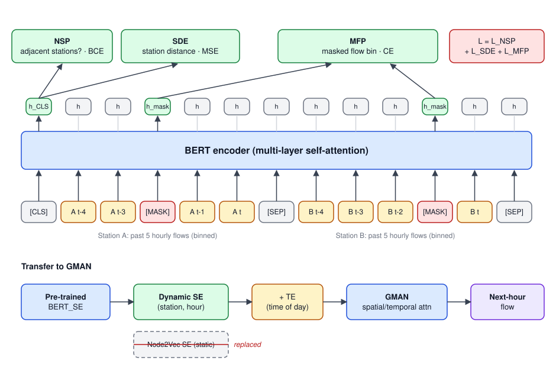

## 論文資訊

| 項目 | 內容 |
|---|---|
| 發表 | 2021 10th International Congress on Advanced Applied Informatics (IIAI-AAI) |
| 作者 | **Wei-Yi Chung**, Yen-Nan Ho, Yu-Hsuan Wu, Jheng-Long Wu |
| DOI | [10.1109/IIAI-AAI53430.2021.00070](https://doi.org/10.1109/IIAI-AAI53430.2021.00070) |
| 程式碼 | [h30306/A-Dynamic-Embedding-Method-for-Passenger-Flow-Estimation](https://github.com/h30306/A-Dynamic-Embedding-Method-for-Passenger-Flow-Estimation) |
| 簡報 | [Conference_Howard_20210706.pdf](https://github.com/h30306/A-Dynamic-Embedding-Method-for-Passenger-Flow-Estimation/blob/main/Conference_Howard_20210706.pdf) |
| 獎項 | [Competitive Paper Award](https://github.com/h30306/A-Dynamic-Embedding-Method-for-Passenger-Flow-Estimation/blob/main/Competitive%20Paper%20Award.pdf) |

這篇是交通計畫的第一篇論文，我是第一作者，負責模型設計、實驗、論文撰寫，並在線上研討會用英文報告。期刊延伸版後來發表在 Knowledge-Based Systems，見 [Dynamic Traffic Network Representation Model]()。

**一句話總結**：把 NLP 的預訓練思路搬到捷運人流上。先讓 BERT 從「兩個站的人流序列」學會站與站之間的距離和人流變化，再把它輸出的**動態站點嵌入**塞進 GMAN，取代原本 Node2Vec 算出來的固定向量。轉乘站的 MAE 從 1.47 降到 0.93。

## 研究動機

### 交通預測為什麼需要嵌入

人流預測的難處在於影響因素很多（時段、站點位置、周邊站點、轉乘關係），而且資料不平衡：大部分時間人流平穩，尖峰只占一小段。直接把原始特徵丟進模型，常常學不好。所以近年的研究傾向先把交通狀態壓成高維向量（embedding），再交給下游模型：

- 用張量分解把多路徑交通型態嵌入成向量，RMSE 改善約 20%。
- 用 graph embedding 加 RNN（GERNN）表示路網，建立交通預測框架。

### 遷移學習在交通上的應用

既然嵌入有用，下一步自然是**預訓練再遷移**：先在一個和交通相關的目標上預訓練，讓模型對交通特性有基本理解，再遷移到下游預測任務。例如：

- 用 CBOW 架構預訓練人的移動軌跡，再遷移到三個以位置預測為基礎的下游任務。
- 預訓練交通事故資訊的嵌入，結合 CNN 和 LSTM 做高速公路車流預測。

### 靜態嵌入的問題

這些方法有一個共同點：嵌入或權重遷移過去之後，每個站（或位置）**對應到一個固定向量**。但交通流量的變化很大，同一個站在尖峰、離峰、平日、假日的狀態完全不同，固定向量的多樣性不夠，模型很難學到更複雜的特徵。當時針對「動態特徵」的研究多半集中在動態圖嵌入（dynamic graph embedding），還沒有人用預訓練的方式產生動態站點嵌入。

### 為什麼選 attention

另一條脈絡是 attention 架構在交通預測上的成功，例如 ASTGCN 用時空 attention 捕捉動態的時空關聯，在 PeMS 兩個資料集都贏過 baseline。Attention 能依重要程度給權重，挑出對目標站最重要的空間特徵，而且不像 RNN 要逐步計算，可以平行化。

綜合以上，這篇的想法是：用**以 attention 為基礎的 BERT** 來產生站點嵌入，而且讓嵌入依「當下的人流」動態改變。下游模型選 GMAN，因為它本身就是 attention 架構，且有一塊明確的 Spatial Embedding（SE）可以替換。

## 問題定義

給定某站過去 `P` 個小時的進出站人流 `X' = (x'_1, …, x'_P)`，預測下一個小時的人流 `y_NTF = x'_{P+1}`（NTF = next time step flow）。

整體流程分兩階段：先預訓練 BERT_SE，再把它接到 GMAN 訓練人流預測。



## 第一階段：BERT_SE 預訓練

### 輸入怎麼組

每筆訓練資料取**同一段時間**的兩個捷運站 a、b，各自取過去 5 個小時的人流：

```text
X_t^S = (x_{t-4}^S, x_{t-3}^S, x_{t-2}^S, x_{t-1}^S, x_t^S)
H_out = BERT_SE(concat[X_t^a, X_t^b])
```

人流是連續數值，直接預測太難，所以先**分箱（binning）** 成類別，讓每個小時的人流變成一個 token（就像一個字）。兩段序列用 BERT 的格式串起來：

```text
[CLS] a(t-4) a(t-3) a(t-2) a(t-1) a(t) [SEP] b(t-4) b(t-3) b(t-2) b(t-1) b(t) [SEP]
```

再沿用 BERT 原本的隨機遮罩（mask）。BERT 透過多層 self-attention，讓兩個站的人流資訊互相注意，輸出每個位置的隱藏狀態 `H_out = [h_1, h_2, …, h_10]`。

### 學習目標

論文正式描述的是兩個自監督目標，同時更新參數：

**SDE（Station Distance Estimation，站距估計）**

從 BERT 的角度看，兩段序列之間最直覺的關聯就是「它們來自的兩個站有多遠」。所以用 `[CLS]` 的輸出預測兩站的直線距離：

```text
ŷ_SDE = W_SDE · h_1 + b_SDE
l_SDE = (y_SDE − ŷ_SDE)²
```

模型因此學到站點之間的空間關係。

**MFP（Masked Flow Prediction，遮罩人流預測）**

預測被遮住的那個小時落在哪個人流區間，讓模型學到整段序列中人流在不同時間點的變化規律：

```text
h_i^FP = LayerNorm(GELU(W_FP1 · h_i + b_FP1))
ŷ_FP  = W_FP2 · h_i^FP + b_FP2
l_FP  = −(1/N) Σ y_FP · log(ŷ_FP)
```

這個預測頭和 BERT 原本 MLM 的 head 結構一樣。

**總損失**是兩者直接相加：`L(θ_SE) = l_SDE + l_FP`，用 Adam 最佳化。

**程式碼裡的第三個目標**：repo 的資料夾叫 `BERT_three_loss`，因為實作上還保留了一個 NSP 風格的 head。它不是 BERT 原本的「下一句預測」，而是改成判斷 **a、b 兩站在路線上是否相鄰**（`Data_preparing_threeloss.py` 裡有一張各站相鄰站的對照表，相鄰標 1、否則標 0），用 BCE loss。程式中的總損失是 `masked_lm_loss + loss_NSP + loss_Dist`。

### 為什麼這樣得到的是「動態」嵌入

因為輸入本身就是**某個站在某段時間的人流**。同一個站在尖峰和離峰會餵進不同的序列，BERT 輸出的向量自然就不同。SDE（以及程式中的相鄰站判斷）讓這個向量同時帶有空間位置的資訊，MFP 則讓它帶有人流時間變化的資訊。

## 第二階段：遷移到 GMAN

### GMAN 是什麼

GMAN（Graph Multi-Attention Network）是 encoder-decoder 架構，由幾個部分組成：

| 元件 | 作用 |
|---|---|
| STAttBlock | 時空 attention block，分別在空間和時間維度做 attention |
| TransAtt | transform attention，把 encoder 的歷史時間步轉換到 decoder 的未來時間步 |
| FC × 2 | 輸入、輸出端的全連接層 |
| STE | 時空嵌入 = SE（Spatial Embedding，地理資訊）+ TE（Temporal Embedding，時間資訊） |

GMAN 原本的 SE 是用 Node2Vec 在路網上算出來的，同一個站永遠是同一個向量，無法依當下的人流特性調整。

### 換掉 SE

這篇只改 SE 這一塊：把歷史人流 `x'_p` 餵進預訓練好的 BERT_SE，得到每個站的動態向量，再組成整張圖的 SE：

```text
se_p = BERT_SE(x'_p)
SE   = (se_1, se_2, …, se_N)        # N = 站數
ŷ_NTF = GMAN(X', BERT_SE)
```

TE 和 GMAN 其他部分完全沿用原論文。GMAN 的損失是預測值與實際值的 MAE：`L(θ_GMAN) = |y_NTF − ŷ_NTF|`，同樣用 Adam 最佳化。

## 實驗設定

### 資料

台北捷運 2017/01 到 2019/03 的每小時進出站人流。依路線是否有交會，把站分成**轉乘站**與**非轉乘站**，各挑 10 站，共 20 站。為了縮小站與站之間的量級差異，所有人流都做 log 正規化。

| 原始資料統計（Table I） | 轉乘站 | 非轉乘站 |
|---|---|---|
| 最大人流 | 10,566 | 46,225 |
| 最小人流 | 0 | 0 |
| 平均人流 | 1,167 | 4,532 |
| 標準差 | 1,356 | 5,329 |
| 樣本數 | 172,710 | 172,710 |

### 切分

依時間切分，避免未來資訊外洩：

| 集合 | 期間 |
|---|---|
| 訓練 | 2017/01 – 2018/09 |
| 驗證 | 2018/09 – 2018/12 |
| 測試 | 2019/01 – 2019/03 |

以下結果都是測試集。

### 超參數（Table II）

| 參數 | 值 | 說明 |
|---|---|---|
| hp | 1, 3, 5 | 餵給 GMAN 的歷史時間點數 |
| fs | 1500, 2000, None | 依距離過濾鄰近站（公尺），None 表示用全部站 |
| lr | 1e-4 | 學習率 |
| es | 64 | BERT 預訓練嵌入維度，也是 GMAN 的 hidden size |

GMAN 的其他參數用原論文設定，BERT 的結構參數也照原本 BERT。

**距離過濾**的用意是只拿目標站附近的站來預測，減少不相關的站帶來的雜訊。統計過濾後的站數：1500 公尺內和 2000 公尺內，每個站都至少有一個鄰近站；平均分別有 6.5 和 9.5 個鄰近站。鄰近站越多的站，越可能是轉乘站或靠近市中心。

### 比較對象與指標

- **node2vec_SE**：原版 GMAN，靜態站點嵌入。
- **BERT_SE**：本文，動態站點嵌入。
- 指標：MAE、RMSE（回歸任務常用的兩個指標）。

## 實驗結果

### 一、靜態 vs 動態嵌入（Table III）

| 站點嵌入 | 轉乘站 MAE | 非轉乘站 MAE |
|---|---|---|
| node2vec_SE | 1.47 | **1.23** |
| BERT_SE | **0.93** | 1.24 |

- **轉乘站大幅改善**：MAE 從 1.47 降到 0.93。轉乘站是人流尖峰、最容易壅塞的地方，在這裡預測得準，實際影響最大。
- **非轉乘站基本持平**：BERT_SE 只差了 0.01。

> 備註：已發表的 Table III 裡 RMSE 那一欄的數字比 MAE 還小，但 RMSE 一定 ≥ MAE，應是排版時欄位出了問題，所以這裡只列 MAE。另外正文寫轉乘站 MAE「0.97」，表格是 0.93，這裡以表格為準。

### 二、歷史時間長度（Table IV）

| 歷史時間點 hp | BERT_SE MAE | BERT_SE RMSE | node2vec_SE MAE | node2vec_SE RMSE |
|---|---|---|---|---|
| 1 | **0.85** | **1.51** | 2.05 | 2.94 |
| 3 | 2.56 | 3.64 | 1.69 | 2.17 |
| 5 | 1.97 | 2.86 | **1.57** | **1.99** |

兩種嵌入的趨勢剛好相反：

- **BERT_SE 只看 1 個時間點就最好**（MAE 0.85）。論文的解釋是對下一個小時影響最大的資訊來自前一個時間點；我的理解是動態嵌入本身已經從 BERT 的 5 小時輸入帶進近期人流，GMAN 再多看幾步沒有額外幫助。
- **node2vec_SE 看越多越好**（2.05 → 1.69 → 1.57）。SE 固定時，模型只能靠更長的歷史人流來補資訊，這也符合 GMAN 本身的設計。

### 三、依距離過濾鄰近站（Table V）

| 過濾 fs | BERT_SE MAE | BERT_SE RMSE | node2vec_SE MAE | node2vec_SE RMSE |
|---|---|---|---|---|
| None | 1.46 | 2.04 | 1.21 | 1.80 |
| 1500 m | **0.83** | **1.50** | **1.18** | **1.59** |
| 2000 m | **0.83** | **1.50** | 1.19 | 1.61 |

- 過濾後兩種嵌入都變好，BERT_SE 的改善特別大（1.46 → 0.83）。這代表一個捷運站的人流主要只受附近站影響，拿全部站來預測不但沒好處，還會讓訓練時間變得很長。
- 1500 和 2000 公尺對 BERT_SE 結果一樣，對 node2vec_SE 則是 1500 公尺稍好。
- 值得注意的是，不過濾（None）時 node2vec_SE 反而比 BERT_SE 好。動態嵌入的優勢要搭配合理的鄰近站範圍才會出現。

## 結論與限制

**結論**：用 BERT_SE 產生的動態嵌入，讓 GMAN 的捷運人流預測整體變好，轉乘站的改善特別明顯，說明動態嵌入的多樣性比靜態嵌入更能表達站點狀態。多目標預訓練也讓模型學到更多面向的交通特徵。

**限制**（回頭看自己的論文）：

- 只用了 20 個站，規模偏小。
- 優勢主要集中在轉乘站，非轉乘站沒有進步。
- BERT_SE 在 hp=3 時反而明顯變差（MAE 2.56），趨勢不單調，論文沒有深入分析原因。
- 論文的未來工作提到，可以加入「下一站預測」之類的新預訓練目標，讓動態嵌入更理解交通流。

期刊版延續這條路：預訓練目標擴充成四個（MFP、同路線、相鄰站、站距），下游改用分時間、站點、路線三層的階層式注意力模型，見 [Dynamic Traffic Network Representation Model]()。

## 程式碼與資源

GitHub repo 包含：

- `Project/data/`：站點資訊、距離矩陣、2019 年範例人流資料（2017、2018 年的原始資料沒有放上去）
- `Project/model/Data_preparing_threeloss.py`：產生預訓練資料（兩站人流序列、站距、是否相鄰）
- `Project/model/BERT_three_loss/`：BERT_SE 預訓練（`run_train.sh`）與產生嵌入（`predict_embeddings.py`）
- 下游預測沿用 [GMAN](https://github.com/zhengchuanpan/GMAN)，把 SE 換成 BERT 輸出即可

本機資料夾另外保留了投稿各版本（`BERTSE_2021xxxx`）、中文版論文初稿、研討會講稿與錄取通知。
