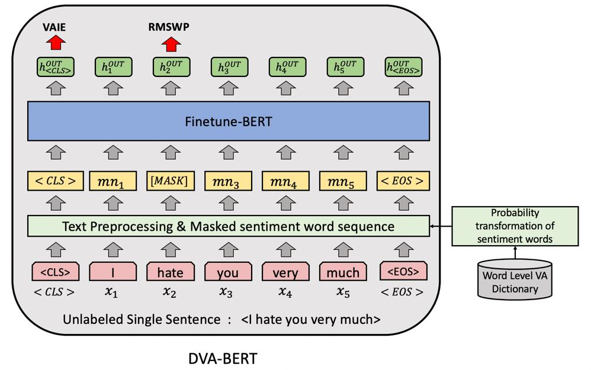

## Paper Info

| Item | Details |
|---|---|
| Venue | Applied Intelligence 52 (14), 16353–16369 (2022) |
| Title | Sentiment-based masked language modeling for improving sentence-level valence–arousal prediction |
| Authors | Jheng-Long Wu, **Wei-Yi Chung** |
| DOI | [10.1007/s10489-022-03384-9](https://doi.org/10.1007/s10489-022-03384-9) |
| Code | [h30306/Sentiment-Based-Masked-Language-Modeling-for-Improving-Sentence-Level-Valence-Arousal-Prediction](https://github.com/h30306/Sentiment-Based-Masked-Language-Modeling-for-Improving-Sentence-Level-Valence-Arousal-Prediction) |

This was one of the first research topics I started in the NLP Lab. In early 2020 I wrote the first version in the IJCAI-PRICAI 2020 format (*A Novel Dimensional Valence-Arousal Prediction Model Using Masked Sentiment Words Approach*), then extended it into a journal paper and, after several rounds of revision in IEEE format, submitted it to Applied Intelligence. Per the paper's CRediT statement, I was responsible for conceptualization, methodology, experiments, and writing.

## Motivation

Sentiment is more than positive versus negative. **Dimensional sentiment (valence–arousal, VA)** uses continuous scores: valence is how positive or negative, arousal is how excited or calm.

BERT's masked language modeling (MLM) masks every token with the same probability regardless of how much it contributes to sentiment, so the learned features do not emphasize the sentiment words in a sentence.

## Model Architecture: DVA-BERT



The example sentence is "I hate you very much"; "hate" is a sentiment word and is replaced by `[MASK]`. The pipeline has four steps:

**1. Word segmentation**: the CKIP tagger splits the sentence into words `X = {x1, …, xN}`.

**2. Sentiment intensity → masking probability**: every word in the CVAW lexicon has valence and arousal scores on a 1–9 scale.

- Valence is first turned into "distance from the midpoint": `TI = |I_V − mid(I_V)|`, so strongly positive or negative words score high.
- It is then min–max normalized and **flipped** with `|norm − 1|`, so lower-intensity words get a higher masking probability. Low-intensity sentiment words are the ones the model confuses most, so it is forced to learn them.
- Arousal gets the same normalization and flip.

**3. Masked sequence**: only sentiment words can be masked; other words have probability 0. Each sentiment word is masked by Bernoulli sampling:

```text
P_mask(x_n) = Bernoulli(β · P_V(x_n)) × Bernoulli(β · P_A(x_n))
```

β is the initial masking probability (a hyperparameter) that stops every sentiment word in a sentence from being masked, which would leave nothing to learn from. The result is `X' = [<CLS>, mn_1, …, mn_N, <EOS>]`.

**4. Two-task training**: `X'` goes through BERT to get a hidden vector per position.

| Task | Output used | What it does | Loss |
|---|---|---|---|
| VAIE (main) | `h_CLS` | Two linear layers output the sentence's valence and arousal | MSE |
| RMSWP (auxiliary) | `h` at `[MASK]` positions | Predict which sentiment word was masked | Cross-entropy |

Both losses train together, and all BERT parameters are fine-tuned.

### Data and Compared Models

The data are 2,300 sentences from mental-health social posts in six categories: depressed mood, suicide, insomnia, work and activity, anxiety, and physical symptoms. Each sentence got valence and arousal scores (1–9) from at least 10 annotators; scores beyond ±1.5 standard deviations were dropped before averaging. The data are split 7:1:2 into train, validation, and test sets with five-fold cross-validation.

The paper compares 11 masking setups:

| Model | Masking |
|---|---|
| DVA-BERT | Proposed: V and A both flipped, probabilities multiplied |
| DVA-BERT-VAI | Same but not flipped (higher intensity, more masking) |
| DVA-BERT-NM | No masking, VAIE only |
| DVA-BERT-RM | Original BERT random masking |
| DVA-BERT-MS | Masks sentiment words without intensity-based probability |
| DVA-BERT-MV / MRV | Valence only, not flipped / flipped |
| DVA-BERT-MA / MRA | Arousal only, not flipped / flipped |
| DVA-BERT-VAU / RVAU | V and A probabilities added (union), not flipped / flipped |

The flipped setups, which mask low-intensity words more often, beat the unflipped MV, MA, and VAU.

## Results

- DVA-BERT beats the original BERT and other word-masking methods.
- An interesting finding: **raising the masking probability of low-intensity sentiment words** works better than masking high-intensity ones. Low-intensity words are more frequent and used more diversely, so learning from them gives more general sentiment features.
- Limitation: training data are single sentences, so masking one word can change the meaning; multi-sentence text would give more masking choices.

## Code and Resources

Each `Models/VA_BERT_*` folder in the repo is one experiment setting:

- `VA_BERT_mask_sentiment`: basic sentiment-word masking
- `*_prob_V`, `*_prob_A`, `*_prob_Intersection`, `*_prob_Union`: masking probability from V/A intensity
- `*_reverse*`: reversed probability (low-intensity words masked more often)
- `*_multilabel`: multi-label variants
- `VA_BERT_no_mask`, `VA_BERT_random_mask`, `VA_BERT_random_init_weight`, `VA_RNN`: baselines

The repo also has `sense_data/` (positive and negative sentiment words; add your own), `data/` (five-fold splits and masking-coverage statistics), `result_statistic/` (collects metrics into CSV), and `Graph/` (paper figures).
