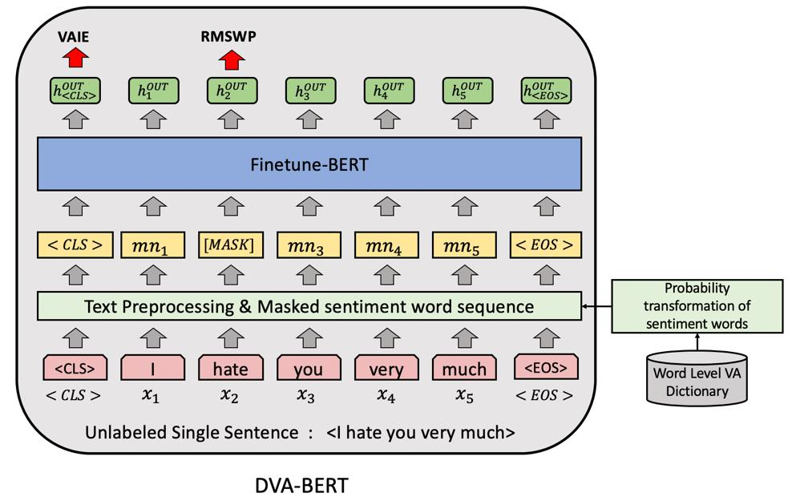

## 論文資訊

| 項目 | 內容 |
|---|---|
| 發表 | Applied Intelligence 52 (14), 16353–16369 (2022) |
| 標題 | Sentiment-based masked language modeling for improving sentence-level valence–arousal prediction |
| 作者 | Jheng-Long Wu, **Wei-Yi Chung** |
| DOI | [10.1007/s10489-022-03384-9](https://doi.org/10.1007/s10489-022-03384-9) |
| 程式碼 | [h30306/Sentiment-Based-Masked-Language-Modeling-for-Improving-Sentence-Level-Valence-Arousal-Prediction](https://github.com/h30306/Sentiment-Based-Masked-Language-Modeling-for-Improving-Sentence-Level-Valence-Arousal-Prediction) |
| 經費 | 科技部計畫 MOST 107-2218-E-031-002-MY2、109-2221-E-031-003、110-2221-E-031-004 |

這是我在 NLP Lab 最早開始的研究題目之一。2020 年初先以 IJCAI-PRICAI 2020 的格式寫成第一版（*A Novel Dimensional Valence-Arousal Prediction Model Using Masked Sentiment Words Approach*），之後擴充成期刊版投到 Applied Intelligence。依論文的 CRediT 聲明，我負責概念發想、方法設計、實驗與撰寫。

## 研究動機

### 為什麼要用 Valence–Arousal

大部分情緒分析只分正面、負面，但這不足以描述人的情緒有多強烈。**維度式情緒（Dimensional Valence–Arousal, DVA）** 用兩個連續數值來表示：

- **Valence**：情緒的方向，正面還是負面。
- **Arousal**：情緒的激動程度，平靜還是激動。

這在精神健康的文本上特別有用。例如「負面又高激動」的留言常出現在憂鬱相關的文章裡，可能反映不穩定的情緒或負面行為；只用正負二分類就看不出這種差別。

### BERT 的隨機遮罩沒有針對情緒

BERT 用 Masked Language Modeling（MLM）預訓練：隨機遮掉 15% 的字，再讓模型猜回來。這讓模型學會看上下文，但**每個字被遮的機率都一樣**，不管它對情緒影響大不大。

過去把 BERT 用在情緒分析的研究，多半只換掉輸入資料和最上層的輸出層，直接微調，沒有特別處理任務領域裡的情緒詞。這篇的想法是：既然遮罩會逼模型去理解被遮位置周圍的語境，**那就專挑情緒詞來遮**，模型就會更專注在情緒詞和它們的用法上。

## 模型架構：DVA-BERT



DVA-BERT 有兩個學習任務：

- **VAIE**（Valence–Arousal Intensity Estimation，主任務）：預測句子的 Valence 和 Arousal。
- **RMSWP**（Random Masked Sentiment Word Prediction，輔助任務）：把原本 BERT 的隨機遮字，改成依情緒強度遮情緒詞，再讓模型猜被遮的是哪個情緒詞。

圖中的例句是「I hate you very much」，「hate」是情緒詞，被換成 `[MASK]`。整個流程分五步。

### 1. 斷詞

用 CKIP tagger 把句子 `s_i` 切成詞 `X = {x1, …, xN}`。

### 2. 情緒詞強度 → 遮罩機率

情緒詞典用 **CVAW**，每個詞都有 1–9 分的 Valence 和 Arousal。

**Valence** 先算「離中間值多遠」：

```text
TI_V(sw) = | I_V(sw) − mid(I_V) |
```

越正面或越負面的詞，`TI_V` 越大。接著做 min–max 正規化，再用 `|norm − 1|` **反轉**：

```text
P_V(sw) = | (TI_V(sw) − min(TI_V)) / (max(TI_V) − min(TI_V)) − 1 |
```

反轉之後，**情緒強度越低的詞，遮罩機率越高**。論文的理由是：強度低的情緒詞最容易讓模型搞不清楚它代表多強的情緒，所以要逼模型多學它們。

**Arousal** 直接做 min–max 正規化後同樣反轉：

```text
P_A(sw) = | (I_A(sw) − min(I_A)) / (max(I_A) − min(I_A)) − 1 |
```

### 3. 產生遮罩序列

只有情緒詞有機會被遮，非情緒詞的機率是 0。每個情緒詞分別對 Valence 和 Arousal 做一次 Bernoulli 抽樣，**兩次都抽中才遮**：

```text
P_mask(x_n) = Bernoulli(β · P_V(x_n)) × Bernoulli(β · P_A(x_n))
```

β 是初始遮罩機率，是一個超參數，用來避免一句話裡的情緒詞被遮太多，導致模型完全學不到原句的意思。最後得到輸入序列：

```text
X' = [<CLS>, mn_1, …, mn_N, <EOS>]
```

### 4. 兩個任務的輸出層

`X'` 進 BERT 後得到每個位置的隱藏向量 `H = [h_CLS, h_1, …, h_N, h_EOS]`。

| 任務 | 用哪個輸出 | 輸出層 | 損失 |
|---|---|---|---|
| VAIE | `h_CLS` | 兩個 Linear，分別輸出 Valence、Arousal | MSE |
| RMSWP | 每個詞位置的 `h_i` | Linear → GELU → LayerNorm → Linear，輸出長度等於情緒詞典大小 | Cross-entropy |

### 5. 訓練

兩個損失加權相加：

```text
L = α · l_VAI + (1 − α) · l_RMSW
```

α 決定模型要多偏向主任務。α = 1 時完全不算輔助任務的損失，但輸入仍然是遮過的句子。BERT 的參數全部會一起微調，優化器是 Adam。

## 資料

### PsychPark 憂鬱語料

資料來自 PsychPark：一個由精神科醫師、心理師和社工志工維護的線上心理診所。共收集 **2,300 句**憂鬱相關文章的句子，分成六類：

| 類別 | 句數 | 比例 | Valence 平均 | Arousal 平均 |
|---|---|---|---|---|
| 憂鬱情緒 | 641 | 27.8% | 3.23 | 4.66 |
| 自殺 | 224 | 9.7% | 1.97 | 5.77 |
| 失眠 | 233 | 10.1% | 3.86 | 3.90 |
| 工作與活動 | 110 | 4.8% | 3.81 | 3.32 |
| 焦慮 | 738 | 32.0% | 3.38 | 5.19 |
| 身體症狀 | 354 | 16.1% | 3.48 | 4.70 |

**標註方式**：每句至少由 10 位標註者獨立給 1–9 分的 Valence 和 Arousal。超出平均 ±1.5 個標準差的分數視為離群值剔除，再取平均。

憂鬱句子的激動程度普遍偏低，Arousal 最高也不超過 6 分。六類裡「自殺」的 Valence 平均最低（1.97）、Arousal 平均最高（5.77）。

### 情緒詞覆蓋率

如果句子裡根本沒有詞典裡的情緒詞，這個方法就沒東西可以遮。論文統計了每類句子中至少含有一個 CVAW 情緒詞的比例：

| 類別 | 句數 | 含情緒詞的句數 | 覆蓋率 |
|---|---|---|---|
| 憂鬱情緒 | 641 | 589 | 91.9% |
| 自殺 | 224 | 169 | 75.4% |
| 失眠 | 233 | 181 | 77.7% |
| 工作與活動 | 110 | 78 | 70.9% |
| 焦慮 | 738 | 658 | 89.2% |
| 身體症狀 | 354 | 255 | 72.0% |

覆蓋率在 70.9% 到 91.9% 之間，所以每次 Bernoulli 抽樣都有很多不同的情緒詞可以選，模型能看到很多種遮法。

## 實驗設定

**切分**：訓練、驗證、測試 7:1:2，做五折交叉驗證，報告的是五折測試集的平均。

**超參數**：

| 參數 | 值 | 說明 |
|---|---|---|
| α | 0.6、0.8、1.0 | VAIE 損失的權重 |
| β | 0.1 到 0.5，每次加 0.05 | 初始遮罩機率 |
| 學習率 | 5e-5 | |

所有模型都從 Google 釋出的中文 BERT 預訓練權重開始。最佳模型依 α 和 β 的最佳組合決定。

**評估指標**：RMSE、MAE、MdAE（絕對誤差的中位數）和 R²。

### 比較的 11 種遮罩方式

| 模型 | 遮罩方式 |
|---|---|
| **DVA-BERT** | 本文方法：V、A 都反轉，兩個抽樣結果相乘（交集） |
| DVA-BERT-VAI | 同上但不反轉，強度越高越容易被遮 |
| DVA-BERT-NM | 不遮罩，只做 VAIE |
| DVA-BERT-RM | 原始 BERT 的隨機遮罩 |
| DVA-BERT-MS | 只遮情緒詞，但不依強度調整機率 |
| DVA-BERT-MV / MRV | 只看 Valence，不反轉 / 反轉 |
| DVA-BERT-MA / MRA | 只看 Arousal，不反轉 / 反轉 |
| DVA-BERT-VAU / RVAU | V、A 機率相加（聯集），不反轉 / 反轉 |

## 實驗結果

### 11 種遮罩方式的比較

- **DVA-BERT 的 RMSE 最低**，標準化加總四個指標後也是整體最好。
- **反轉的版本比較好**：MRV、MRA、RVAU 都贏過不反轉的 MV、MA、VAU。論文的解釋是，低強度的情緒詞出現頻率高、用法也比較多樣，多遮它們能讓模型學到更細緻的情緒差異。
- **DVA-BERT-MS 最差**：它把所有情緒詞都當候選、不看強度，遮掉的字太多，短句的原意被破壞，模型學不到句子本來的情緒。
- DVA-BERT-VAI 和 RVAU 也不錯，代表同時考慮兩個情緒維度來挑遮罩詞，比只看一個維度準。
- 只看 Valence 的 MRV 表現也很好，代表 Valence 詞在句子的情緒表達中佔了很大比重。

### 有沒有情緒詞的句子

把測試句分成「含情緒詞」和「不含情緒詞」兩組（節錄）：

| 模型 | 含情緒詞 RMSE | MAE | R² | 不含情緒詞 RMSE | MAE | R² |
|---|---|---|---|---|---|---|
| DVA-BERT-RM | 1.36 | 1.06 | 0.81 | 1.49 | 1.14 | 0.59 |
| DVA-BERT-NM | 1.35 | 1.04 | 0.82 | 1.51 | 1.14 | 0.51 |
| DVA-BERT-MS | 1.41 | 1.08 | 0.73 | 1.54 | 1.18 | 0.45 |
| DVA-BERT-VAI | 1.33 | 1.02 | 0.86 | 1.48 | 1.14 | 0.58 |
| DVA-BERT-RVAU | 1.35 | 1.04 | 0.84 | 1.50 | 1.17 | 0.53 |
| **DVA-BERT** | **1.32** | **1.02** | **0.88** | **1.46** | **1.13** | **0.60** |

- 所有模型在含情緒詞的句子上都比較準，說明情緒詞對句子的情緒影響很大。
- 在含情緒詞的句子上，DVA-BERT 四個指標都明顯贏過不遮罩的 NM，代表學著猜情緒詞確實有幫助。
- 有意思的是，在**不含情緒詞**的句子上，DVA-BERT 的 RMSE、MAE、R² 也是最好的：遮情緒詞學到的東西可以遷移到沒有情緒詞的句子。

### 損失權重 α

- DVA-BERT 在 **α = 0.8** 時 MAE 最低，也就是主任務佔 80%、輔助任務佔 20%。
- MS、MA、VAU 這幾個遮很多字的模型，α 越大（越偏主任務）越好；RM 和 VAI 則相反；其他模型沒有穩定趨勢。
- 論文的推論是：**遮的字少時，猜字能幫主任務；遮太多字時，猜字反而變成負擔。**
- 即使 α = 1、完全不算輔助任務的損失，不同遮罩方式的結果仍然不同。這說明「輸入時遮掉哪些詞」本身就會影響模型學到什麼。

### 初始遮罩機率 β

論文畫出每個模型在訓練時平均遮了幾個字對 β 的關係：

- RM、MS、VAU、MRA 這些**本來就遮很多字**的模型，最佳 β 都偏低，要靠降低 β 來減少遮罩數。
- MV、RVAU 和 DVA-BERT 這些**初始遮罩數少**的模型，可以用比較高的 β，彈性地選擇遮哪裡，最後表現也最好。

### 預訓練權重的影響

| 模型 | RMSE | MAE | MdAE | R² |
|---|---|---|---|---|
| DVA-BERT-INIT（隨機初始化） | 1.79 | 1.38 | 0.55 | 0.52 |
| DVA-BERT（預訓練權重） | **1.33** | **1.03** | **0.41** | **0.70** |

不用預訓練權重，RMSE 從 1.33 退到 1.79。情緒詞遮罩是建立在 BERT 原本的語言能力之上的。

### 和序列模型比較

| 模型 | RMSE | MAE | MdAE | R² |
|---|---|---|---|---|
| **DVA-BERT** | **1.33** | **1.03** | **0.41** | **0.70** |
| DVA-BERT-NM | 1.42 | 1.12 | 0.44 | 0.68 |
| Bi-RNN | 1.68 | 1.30 | 0.48 | 0.63 |
| Bi-LSTM | 1.75 | 1.35 | 0.57 | 0.59 |
| Bi-GRU | 1.71 | 1.32 | 0.51 | 0.51 |

三個雙向序列模型的隱藏層與詞嵌入大小都設成和 BERT 一樣的 768，學習率與 epoch 也相同。BERT 系列明顯比較好；而在序列模型裡，最簡單的 Bi-RNN 反而贏過 Bi-LSTM 和 Bi-GRU，因為資料都是短句，用不到 LSTM 處理長距離依賴的能力。

### 公開資料集

為了確認方法不只適用憂鬱語料，論文另外在 Yu et al. 的中文句子 VA 資料集上測試。這份資料是各種論壇留言，大部分句子都含情緒詞：

| 模型 | RMSE | MAE | MdAE | R² |
|---|---|---|---|---|
| **DVA-BERT** | **1.03** | **0.81** | **0.38** | **0.72** |
| DVA-BERT-RM | 1.27 | 0.93 | 0.43 | 0.62 |
| DVA-BERT-NM | 1.26 | 0.91 | 0.44 | 0.64 |

DVA-BERT 在四個指標上都贏過隨機遮罩和不遮罩的版本，代表這個遮罩機制在不同領域的資料上也有效。

## 討論與限制

- DVA-BERT 好的原因是：它**同時考慮 V 和 A 的強度**來決定遮哪些情緒詞，讓模型更專注在情緒詞附近的語境。
- 用聯集（VAU、RVAU）沒有明顯進步，因為遮的情緒詞太多，輔助任務變得太難學。
- **限制**：訓練資料都是單句，即使只遮一個詞也可能改變句意，模型就學不到原句的情緒。未來可以用多句文本，讓候選遮罩詞更多、遮法更多樣，也可以把這個遮罩方式套到其他 attention-based 模型上。

## 程式碼與資源

repo 中每個 `Models/VA_BERT_*` 資料夾對應一組實驗設定，README 裡有一張表，對照資料夾、訓練腳本和論文裡的模型名稱（例如 DVA-BERT 是 `VA_BERT_mask_sentiment_prob_Intersection_reverse`，用 `run_train_MSPRIN_kfold*.sh` 訓練）。

另外還有 `sense_data/`（正負向情緒詞，可自行加詞）、`data/`（五折切分資料與遮罩覆蓋率統計）、`result_statistic/`（彙整實驗指標成 CSV）、`notebooks/`（論文圖表的繪圖程式）和 `Graph/`（論文圖表）。
