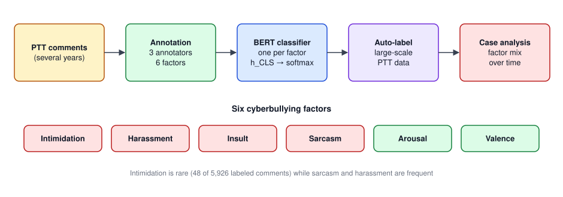

## Paper Info

| Item | Details |
|---|---|
| Venue | 2022 IEEE International Conference on Big Data (Big Data) Workshop, pp. 4323–4329 |
| Authors | Yu-Hsuan Wu, Sheng-Wei Huang, **Wei-Yi Chung**, Chen-Chia Yu, Jheng-Long Wu |
| DOI | [10.1109/BigData55660.2022.10020779](https://doi.org/10.1109/BigData55660.2022.10020779) |
| Slides | [BigD809.pdf](https://github.com/h30306/Factor-Detection-Task-of-Cyberbullying-Using-the-Deep-Learning-Model/blob/main/BigD809.pdf) |
| Code | The [repo](https://github.com/h30306/Factor-Detection-Task-of-Cyberbullying-Using-the-Deep-Learning-Model) only has the slides; no code yet |

This paper continues the lab's MOST-funded cyberbullying project, which started in 2019. The early proposals pre-trained BERT on valence–arousal and transferred it to bullying detection; this paper moves the question from "is this bullying?" to "which factors make up the bullying?".

**In one sentence**: derive six annotatable factors from the definition of bullying, build a Chinese cyberbullying-factor corpus from PTT, train BERT classifiers, then use them to auto-label about 280k comments and compare bullying patterns across five public-figure events.

## Motivation

Social media spreads ideas fast and produces huge amounts of analyzable data every day, but the same channels amplify verbal abuse. Compared with clearly defined crimes such as identity theft or fraud, cyberbullying does serious harm to individuals yet is hard to punish or prevent because its **definition is vague**. Studies have found that victims of cyberbullying show the highest levels of depressive symptoms, and others have proposed links between cyberbullying and online hate crime.

Most prior work only does **bullying detection** (yes/no). Bullying is made of many factors, though, and a coarse binary label does not help researchers understand what bullying looks like in a given community. This paper offers an analysis method: break bullying into factors, recognize them automatically with AI, and use that to track bullying patterns in specific communities and forums.

## From Definition to Six Factors

### Defining bullying

Classic bullying research defines bullying by three conditions: **intent** to harm, **repetition**, and a **power imbalance**. Cyberbullying is different: anonymity makes repetition and power imbalance hard to judge. A study of adolescents found neither power imbalance nor repetition decided whether they felt bullied; what mattered were **intent** and **perceived harm**.

### Deriving the factors

Judging "intent" alone gives inconsistent standards depending on the role (bully vs victim), so this paper reads comments **from the victim's perspective** to decide whether a sentence carries intent to harm:

- **Directly harmful language**: aggressive and offensive speech can be made more specific as **intimidation, harassment and insult**. Hate speech is usually discriminatory and demeaning, so it falls under insult.
- **Indirectly harmful language**: oblique hurtful sentences are defined as **sarcasm**.
- **Whether the victim perceives harm**: described by **arousal** and **valence**. Sentences with strong wording or strong emotions such as disgust can also hurt.

### Annotation rules

| Factor | Definition | Labels |
|---|---|---|
| Intimidation | Using words to threaten the other person into fear | Yes / No |
| Harassment | Various offensive behaviour, understood as repeated, unwelcome disruption whose only purpose is to cause alarm, annoyance or emotional distress; includes sexual harassment | Yes / No |
| Insult | Insulting, demeaning, discriminatory or hateful words | Yes / No |
| Sarcasm | Satire, irony, ridicule, teasing; exposing the target's contradictions or flaws through metaphor rather than direct attack | Yes / No |
| Arousal | Whether the commenter shows clear emotional swings in tone, wording, punctuation or emoticons | Yes / No |
| Valence | The emotion the bullied person would feel reading the comment | Positive / Neutral / Negative |

**Harassment vs insult** is the easiest pair to confuse: insult has a clear demeaning meaning, while harassment need not contain insulting words; mocking or joking can count as harassment without being demeaning.

## How This Differs from Existing Corpora

English bullying corpora are plentiful (Ask.fm, Formspring, Myspace, Twitter, plus Facebook and YouTube APIs), but most only label bullying vs non-bullying or add a toxicity score. Non-English corpora have been growing: Malay combining sentiment, emotion and toxicity; 4,505 Arabic tweets; and in Chinese, a WeChat inflammatory-word corpus, COLA (abusive, anti-social and illegal language), JRTT (bullying vs non-bullying in COVID-19 news comments) and a severity corpus graded mild/moderate/severe by intent, repetition and aggression.

Most of these still treat bullying as binary, or use broad notions like "offensive language" without telling whether it is sarcasm, insult or intimidation. The six-factor corpus fills that gap.

## Pipeline and Model



The pipeline has four steps:

1. **Collect data**: posts with many comments serve as bullying samples, collected from PTT over several years.
2. **Annotate manually** with the rules above.
3. **Build classifiers**: deep learning models learn hidden features of each factor.
4. **Big-data analysis**: auto-label a large dataset with the classifiers and study factor distributions in case studies.

### Classifier

Each factor gets its own BERT classifier, framed as classification:

```text
{h_CLS, h_1, …, h_n} = BERT_f({[CLS], w_1, …, w_n})
v_f = h_CLS
ŷ   = softmax(W · v_f + b)
L(θ) = −(1/N) Σ_n Σ_c y_{n,c} · log(ŷ_{n,c})
```

After BERT, `h_CLS` already carries information from every word, so it represents the whole comment. The full model (BERT encoder + prediction layer) is trained end to end with mini-batches and Adam using cross-entropy.

## Experiments

### Dataset

PTT yielded **1,508,644 posts and 71,003,763 comments**. 125 posts with 5,926 comments were randomly sampled from posts about recent internet-celebrity events and annotated to build the Chinese cyberbullying-factor corpus. Posts were split 7:1:2 into train/validation/test, with 5-fold cross-validation.

| Factor | Yes | No |
|---|---|---|
| Intimidation | 48 | 5,878 |
| Harassment | 2,175 | 3,751 |
| Insult | 1,603 | 4,323 |
| Sarcasm | 3,641 | 2,285 |
| Arousal | 1,618 | 4,308 |

| | Positive | Neutral | Negative |
|---|---|---|---|
| Valence | 37 | 2,598 | 2,349 |

The data are heavily imbalanced: only 48 intimidation comments, but lots of sarcasm and harassment. Valence has similar neutral and negative counts and almost no positives. (The three valence classes sum to 4,984, fewer than 5,926; the paper does not explain the difference.)

### Annotation agreement

Three annotators labelled every comment; the gold label is the majority vote. Agreement was measured with Cronbach's alpha:

| Factor | Cronbach's α |
|---|---|
| Intimidation | 0.56 |
| Harassment | 0.65 |
| Insult | **0.69** |
| Sarcasm | 0.61 |
| Arousal | 0.53 |
| Valence | 0.63 |

Annotating bullying factors is hard in itself:

- **Insult agrees best**, since it can mostly be judged from swear words and demeaning terms.
- **Harassment is close to insult**, but harassing sentences take many forms, which causes disagreement.
- **Intimidation is low**, possibly because there is so little of it.
- **Arousal is lowest**: emotional swings are easily coloured by an annotator's own views.
- **Sarcasm and valence are similar**: sarcasm can be phrased in countless ways, and valence must be judged from the victim's side, where people perceive harm differently.

### Models compared

| Model | Description |
|---|---|
| BERT_α | Proposed architecture with `distilbert-base-multilingual-cased` |
| BERT_β | Proposed architecture with `bert-base-multilingual-uncased` |
| SVM | Baseline: TF-IDF features + support vector machine |
| RFC | Baseline: TF-IDF features + random forest |

### Results (macro F1, averaged over 5 folds)

| Model | Arousal | Harassment | Insult | Intimidation | Sarcasm | Valence |
|---|---|---|---|---|---|---|
| BERT_α | 0.60 | **0.63** | **0.66** | 0.69 | 0.58 | 0.43 |
| BERT_β | **0.61** | **0.63** | **0.66** | **0.77** | **0.59** | **0.47** |
| SVM | 0.40 | 0.43 | 0.47 | 0.52 | 0.44 | 0.20 |
| RFC | 0.38 | 0.43 | 0.46 | 0.52 | 0.44 | 0.20 |

- **Deep learning clearly beats classic ML**: BERT's macro F1 is well above SVM and RFC on every factor.
- **Classic models sometimes have higher precision**: for insult, SVM's macro precision is 0.79 vs BERT's 0.66, but SVM's recall is only 0.52. Classic models tend to put everything in one class, which causes many errors.
- **BERT_β slightly beats BERT_α**: DistilBERT is a slimmed-down BERT with fewer parameters and layers and faster inference, but detecting bullying factors is a fairly complex task that needs more hidden features.
- **Valence is hardest** (0.47 at best), consistent with it being three-way, having almost no positives, and having only moderate agreement.

BERT_β was chosen for auto-labelling: the five fold models each predict every comment and a **majority vote** decides the final label.

## Case Studies: Five Public-Figure Events

For each event, posts and comments were collected by keyword from the start of the event to the crawl date:

| Event | Type | Posts | Comments |
|---|---|---|---|
| Johnny Depp and Amber Heard lawsuit | Celebrity | 17 | 2,499 |
| Kris Wu (Yi Fan Wu) sex scandal | Celebrity | 134 | 29,908 |
| Alisasa controversies | Internet celebrity | 207 | 37,042 |
| Toyz events | Internet celebrity | 137 | 28,792 |
| Han Kuo-yu recall | Politician | 800 | 181,189 |
| Total | | 1,295 | 279,430 |

> The paper's table lists 1,881,189 comments for the Han Kuo-yu event and a total of 1,979,430, which conflicts with the 279,430 in the text. With 181,189 the column sums to exactly 279,430, so the table most likely has an extra digit.

Each event gets three charts:

- **Factor proportion line chart**: the daily share of comments showing each factor, averaged by month (weekly for the Han Kuo-yu event, which has far more comments).
- **Valence line chart**: how positive, neutral and negative comments change.
- **Factor correlation heat map**: correlation of daily comment counts per factor; the more correlated two factors are, the more often they appear together.

Bullying patterns by event:

| Event | Main pattern | Notable |
|---|---|---|
| Johnny Depp | High arousal plus sarcasm, insult and harassment, with similar trends and weak-to-moderate correlation | A clear dip in August 2021 when discussion turned more neutral and positive comments jumped; afterwards the three factors returned to earlier levels and criticism shifted to the other party |
| Kris Wu | Insult and harassment, strongly correlated | Sex-related discussion makes harassment (including sexual harassment) stand out; intimidation briefly ran high in 2018; after the 2021 turning point, sarcasm imitating the accuser's remarks surged along with negative comments |
| Alisasa | Harassment and insult, moderately correlated | Sarcasm correlates weakly with them; the controversies involved remarks on discrimination, flaunting wealth and unproven medical claims |
| Toyz | Mostly harassment before 2021, with relatively rational discussion | A 2020 video of jumping off a building to honour a bet caused a peak in arousal and harassment; after 2021 insult, sarcasm and harassment converged into a pattern similar to Johnny Depp's |
| Han Kuo-yu | Sarcasm, harassment and insult with very stable trends | Arousal stays above 60% almost throughout; sarcasm and harassment correlate clearly, as discussion often reaches back to earlier episodes of his political career |

## Findings and Conclusion

- **Comments with bullying factors are highly emotional**: arousal is high in every event.
- **Intimidation is rare**, perhaps because online communication still carries some moral restraint. In some posts it trends with insult and harassment, suggesting overlapping features, but there is too little data to confirm.
- **Insult, harassment and sarcasm are the most related factors**: insult and harassment correlate in every event, while sarcasm correlates clearly only in certain events (e.g. sarcasm plus harassment for the politician).
- **Bullying patterns shift with turning points in an event**, and the model's time series match how each event actually unfolded, which also supports the method.

Contributions:

- Derived annotatable cyberbullying factors from the definition of bullying and field observation, and built a Chinese cyberbullying-factor corpus.
- Auto-labelled posts and analysed bullying patterns with BERT.
- The method lets future work model and analyse bullying patterns in specific domains.

## Code and Resources

The GitHub repo currently has only the slides PDF and a README, no model code. My local cyberbullying project folders (2019, 2020, 2021) keep every version of the MOST proposals, the review comments and architecture diagrams.
