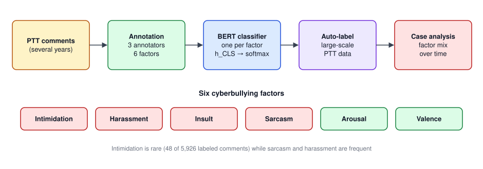

## 論文資訊

| 項目 | 內容 |
|---|---|
| 發表 | 2022 IEEE International Conference on Big Data (Big Data) Workshop, pp. 4323–4329 |
| 作者 | Yu-Hsuan Wu, Sheng-Wei Huang, **Wei-Yi Chung**, Chen-Chia Yu, Jheng-Long Wu |
| DOI | [10.1109/BigData55660.2022.10020779](https://doi.org/10.1109/BigData55660.2022.10020779) |
| 簡報 | [BigD809.pdf](https://github.com/h30306/Factor-Detection-Task-of-Cyberbullying-Using-the-Deep-Learning-Model/blob/main/BigD809.pdf) |
| 程式碼 | [repo](https://github.com/h30306/Factor-Detection-Task-of-Cyberbullying-Using-the-Deep-Learning-Model) 目前只有簡報，沒有程式碼 |

這篇延續實驗室從 108 年開始的科技部網路霸凌計畫。前期計畫書是用 Valence–Arousal 預訓練 BERT 再遷移到霸凌偵測，這篇則把問題從「是不是霸凌」推進到「霸凌由哪些因子構成」。

**一句話總結**：先從霸凌的定義拆出六個可以標註的因子，在 PTT 上建立中文霸凌因子語料，訓練 BERT 分類器，再拿它自動標註近 28 萬則留言，看五個公眾人物事件裡的霸凌模式各長什麼樣子。

## 研究動機

社群媒體讓意見快速流通，也每天產生大量可以分析的資料；但同樣的管道也放大了言語暴力。相較於盜取個資、詐騙這些容易界定的犯罪，網路霸凌對個人的傷害很大，卻因為**定義模糊**而難以懲處或預防。已有研究指出，遭受網路霸凌的人憂鬱症狀最嚴重，也有研究提出網路霸凌和網路仇恨犯罪可能有關聯。

過去研究大多只做**霸凌偵測**（是／不是），但霸凌其實由很多因子組成，粗略的二分類沒辦法幫研究者理解一個場域裡的霸凌狀況。這篇想提供一套分析方法：把霸凌拆成多個因子、用 AI 自動辨識，進一步追蹤特定社群或論壇的霸凌模式。

## 從定義到六個因子

### 霸凌的定義

傳統霸凌研究把霸凌定義為三個要件：**意圖**傷害、**重複**發生、雙方**權力不對等**。但網路霸凌比較特別：因為匿名，重複性和權力不對等都很難判斷。一項針對青少年的研究發現，權力不對等和重複性都不是他們判斷「有沒有被霸凌」的關鍵，真正重要的是**意圖**和**感受到的傷害**。

### 從定義拆出因子

只看「意圖」會因為角色不同（霸凌者 vs 受害者）而標準不一，所以這篇以**受害者的角度**閱讀留言，判斷是否為「有傷害意圖的句子」：

- **直接傷害的語言**：攻擊性、冒犯性的言論可以更具體地分成**恐嚇、騷擾、侮辱**。仇恨言論通常帶有歧視和貶低，歸在侮辱。
- **間接傷害的語言**：拐彎抹角的傷害句定義為**反諷**。
- **受害者是否感受到傷害**：用**激動程度（Arousal）**和**情緒正負向（Valence）**描述。用詞強烈、帶噁心等強烈情緒的句子也會造成傷害。

### 標註規則

| 因子 | 定義 | 標籤 |
|---|---|---|
| 恐嚇 Intimidation | 用言語威脅對方使其恐懼 | 是／否 |
| 騷擾 Harassment | 各種冒犯行為，可理解為重複且不受歡迎的干擾；除了引起驚慌、煩躁、情緒困擾之外沒有其他目的；包含性騷擾 | 是／否 |
| 侮辱 Insult | 含有侮辱、貶低、歧視、仇恨的字詞 | 是／否 |
| 反諷 Sarcasm | 諷刺、反語、嘲弄、揶揄等，不直接攻擊，而是用隱喻揭露對方的矛盾或缺點 | 是／否 |
| 激動程度 Arousal | 從語氣、用詞、標點、表情符號判斷留言者是否有明顯的情緒起伏 | 是／否 |
| 情緒正負向 Valence | 以被霸凌者的角度閱讀後會產生的情緒 | 正向／中性／負向 |

**騷擾 vs 侮辱**最容易混淆：侮辱有明確的貶低意涵；騷擾不一定有侮辱字眼，取笑、開玩笑也可能算騷擾，但不一定是在貶低對方。

## 和既有語料的差異

英文霸凌語料很多（Ask.fm、Formspring、Myspace、Twitter，以及 Facebook、YouTube 的 API），但多半只標「是／否霸凌」或加一個毒性分數。非英文語料近年慢慢變多：馬來文結合情感、情緒、毒性三個標準；阿拉伯文標了 4,505 則推文；中文有微信的煽動性字詞語料、COLA（辱罵、反社會、違法語言）、JRTT（COVID-19 新聞留言的霸凌與否），以及依意圖、重複、攻擊性分輕中重度的嚴重程度語料。

這些語料大多仍把霸凌當二分類，或只看「冒犯性語言」這類籠統概念；冒犯性語言裡具體是反諷、侮辱還是恐嚇，它們分不出來。這篇的六因子語料就是要補這塊。

## 研究流程與模型架構



整個流程分四步：

1. **收集資料**：以「留言很多的貼文」作為霸凌樣本來源，從 PTT 收集多年的資料。
2. **人工標註**：依上面的規則標註六個因子。
3. **建立分類器**：訓練深度學習模型學習霸凌因子的隱藏特徵。
4. **大數據分析**：用分類器自動標註大量資料，觀察幾個案例中各因子的分布。

### 分類器

每個因子各訓練一個 BERT 分類器，當作分類任務處理：

```text
{h_CLS, h_1, …, h_n} = BERT_f({[CLS], w_1, …, w_n})
v_f = h_CLS
ŷ   = softmax(W · v_f + b)
L(θ) = −(1/N) Σ_n Σ_c y_{n,c} · log(ŷ_{n,c})
```

`h_CLS` 經過 BERT 後已經包含整則留言所有字的資訊，所以直接拿來代表整則留言。整個模型（BERT encoder + 預測層）用 mini-batch 和 Adam 端到端訓練，損失是 cross-entropy。

## 實驗

### 資料集

從 PTT 共收集 **1,508,644 篇貼文、71,003,763 則留言**。從近年網紅事件相關的貼文中隨機抽出 125 篇、5,926 則留言做人工標註，建立中文霸凌因子語料。貼文以 7:1:2 切成訓練、驗證、測試集，並做 5-fold 交叉驗證。

| 因子 | 是 | 否 |
|---|---|---|
| 恐嚇 | 48 | 5,878 |
| 騷擾 | 2,175 | 3,751 |
| 侮辱 | 1,603 | 4,323 |
| 反諷 | 3,641 | 2,285 |
| 激動程度 | 1,618 | 4,308 |

| | 正向 | 中性 | 負向 |
|---|---|---|---|
| Valence | 37 | 2,598 | 2,349 |

資料相當不平衡：恐嚇只有 48 則；反諷、騷擾則很多。Valence 的中性和負向數量接近，正向極少。（Valence 三類加總 4,984 則，少於 5,926，原文沒有說明差異。）

### 標註一致性

每則留言由三位標註者標註，以多數決作為正解，用 Cronbach's Alpha 評估一致性：

| 因子 | Cronbach's α |
|---|---|
| 恐嚇 | 0.56 |
| 騷擾 | 0.65 |
| 侮辱 | **0.69** |
| 反諷 | 0.61 |
| 激動程度 | 0.53 |
| 情緒正負向 | 0.63 |

霸凌因子的標註本身就很難：

- **侮辱一致性最好**，因為大多可以靠髒話、貶低字眼判斷。
- **騷擾和侮辱接近**，但騷擾句的組成很多樣，容易判斷不一。
- **恐嚇偏低**，可能受資料量太少影響。
- **激動程度最低**，句子的情緒起伏容易受標註者個人看法影響。
- **反諷和 Valence 接近**：反諷句的寫法太多種；Valence 要從受害者的角度判斷，每個人對「受到傷害」的感受不同。

### 比較模型

| 模型 | 說明 |
|---|---|
| BERT_α | 本文架構，預訓練模型用 `distilbert-base-multilingual-cased` |
| BERT_β | 本文架構，預訓練模型用 `bert-base-multilingual-uncased` |
| SVM | 基線：TF-IDF 特徵 + 支持向量機 |
| RFC | 基線：TF-IDF 特徵 + 隨機森林 |

### 結果（5-fold 平均的 Macro F1）

| 模型 | 激動程度 | 騷擾 | 侮辱 | 恐嚇 | 反諷 | 情緒正負向 |
|---|---|---|---|---|---|---|
| BERT_α | 0.60 | **0.63** | **0.66** | 0.69 | 0.58 | 0.43 |
| BERT_β | **0.61** | **0.63** | **0.66** | **0.77** | **0.59** | **0.47** |
| SVM | 0.40 | 0.43 | 0.47 | 0.52 | 0.44 | 0.20 |
| RFC | 0.38 | 0.43 | 0.46 | 0.52 | 0.44 | 0.20 |

- **深度學習明顯勝過傳統機器學習**：BERT 的 Macro F1 在每個因子都比 SVM、RFC 高一截。
- **但傳統模型的 Precision 有時更高**：例如侮辱，SVM 的 Macro Precision 是 0.79，BERT 只有 0.66；可是 SVM 的 Recall 只有 0.52。傳統模型傾向把句子都判成同一類，造成大量分類錯誤。
- **BERT_β 略勝 BERT_α**：DistilBERT 是 BERT 的精簡版，參數和層數較少、速度較快；但判斷留言有沒有霸凌因子是相對複雜的任務，需要學更多隱藏特徵。
- **Valence 最難**（最好也只有 0.47），和它三分類、正向極少、標註一致性也不高有關。

最後選 BERT_β 做自動標註：5 個 fold 各自訓練出的模型都對每則留言預測一次，**投票**決定最終標籤。

## 案例分析：五個公眾人物事件

用每個事件的關鍵字，從事件開始到爬資料當下為區間，收集相關貼文與留言：

| 事件 | 類型 | 貼文 | 留言 |
|---|---|---|---|
| Johnny Depp 與 Amber Heard 訴訟 | 名人 | 17 | 2,499 |
| 吳亦凡性醜聞 | 名人 | 134 | 29,908 |
| 愛莉莎莎爭議 | 網紅 | 207 | 37,042 |
| Toyz 事件 | 網紅 | 137 | 28,792 |
| 韓國瑜罷免 | 政治人物 | 800 | 181,189 |
| 合計 | | 1,295 | 279,430 |

> 原表中韓國瑜事件的留言數寫成 1,881,189、合計 1,979,430，和正文的 279,430 對不起來；改成 181,189 後加總剛好等於 279,430，應是表格多打了一位。

每個事件畫三張圖：

- **因子比例折線圖**：每天算出符合各因子的留言占比，再按月平均（韓國瑜事件留言太多，改用週）。
- **Valence 折線圖**：正向、中性、負向留言的變化。
- **因子相關熱圖**：用每天各因子的留言總數算相關係數，兩個因子越相關，代表越常一起出現。

各事件的霸凌模式：

| 事件 | 主要模式 | 值得注意的地方 |
|---|---|---|
| Johnny Depp | 高激動 + 反諷、侮辱、騷擾，三者趨勢相近、弱到中度相關 | 2021/08 出現明顯低谷，討論轉趨中立，正向留言大增；之後三個因子回到原本水準，譴責的對象也轉向另一方 |
| 吳亦凡 | 侮辱與騷擾為主，兩者相關較強 | 性相關討論讓騷擾（含性騷擾）特別突出；2018 年一度出現較高比例的恐嚇；2021 事件轉折後模仿當事人發言的反諷大量出現，負向留言急增 |
| 愛莉莎莎 | 騷擾與侮辱為主，兩者中度相關 | 反諷和它們相關性低；事件涉及歧視、炫富、未經證實的醫療說法等爭議言論 |
| Toyz | 2021 年前以騷擾為主，討論相對理性 | 2020 年為履行賭約的跳樓影片造成激動與騷擾的高峰；2021 年後侮辱、反諷、騷擾趨勢靠攏，模式變得和 Johnny Depp 相似 |
| 韓國瑜 | 反諷、騷擾、侮辱，三者趨勢非常穩定 | 激動程度幾乎都在 60% 以上；反諷和騷擾的相關性明顯，因為討論常延伸到政治生涯中的舊事件 |

## 發現與結論

- **含霸凌因子的留言普遍很激動**：每個事件的 Arousal 比例都很高。
- **恐嚇非常少見**：可能因為網路溝通仍有一定的道德約束力。但在部分貼文中，恐嚇的趨勢和侮辱、騷擾相似，推測恐嚇句的特徵和它們有交集，只是資料量太少難以確認。
- **最相關的三個因子是侮辱、騷擾、反諷**：侮辱和騷擾在每個事件都相關；反諷只在特定事件中明顯相關（例如政治人物的反諷 + 騷擾）。
- **霸凌模式會隨事件轉折而改變**：模型預測的時間序列和各事件的實際發展相符，也間接驗證了方法的有效性。

貢獻總結：

- 從霸凌的定義和實際觀察出發，萃取出可標註的霸凌因子，建立中文霸凌因子語料。
- 用 BERT 自動標註並分析霸凌模式。
- 這套方法可以讓後續研究針對特定場域建模、分析霸凌模式。

## 程式碼與資源

GitHub repo 目前只有簡報 PDF 和 README，沒有模型程式碼。本機的霸凌計畫資料夾（108、109、110）保留了科技部計畫書各版本、審查意見與架構圖。
