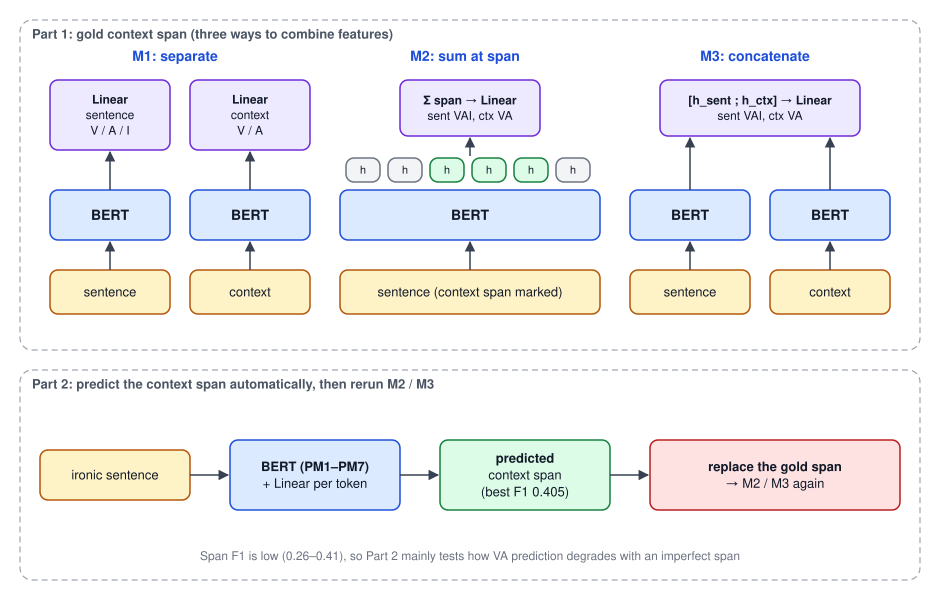

## Paper Info

| Item | Details |
|---|---|
| Venue | International Journal of Computational Linguistics & Chinese Language Processing (IJCLCLP) Vol. 27, No. 2, pp. 73–88, December 2022 |
| Authors | Jheng-Long Wu, Sheng-Wei Huang, **Wei-Yi Chung**, Yu-Hsuan Wu, Chen-Chia Yu |
| Links | [ACL Anthology](https://aclanthology.org/2022.ijclclp-2.5/) · [PDF](https://aclanthology.org/2022.ijclclp-2.5.pdf) |
| Code | No public repo |
| Conference version | [A Dimensional Valence-Arousal-Irony Dataset for Chinese Sentence and Context]() (ROCLING 2022) |
| Funding | MOST 110-2221-E-031-004, MOST 111-2221-E-031-004-MY3 |

## What Changed from the Conference Version

The dataset is the same CDVAI (1,004 ironic sentences, 843 ironic contexts); the annotation guidelines, annotator agreement, and score distribution match the [ROCLING version]() and are not repeated here. What is new is the modeling:

| | ROCLING 2022 | IJCLCLP 2022 |
|---|---|---|
| Where M1/M2/M3 apply | Context-level VA only | **Both sentence-level VAI and context-level VA** |
| Pre-trained models | 4 Chinese + 2 multilingual | **6 Chinese** (MacBERT, RoBERTa, and three Erlangshen models) |
| Context position | Human-annotated span | Also trains a model to **predict the span automatically** and reruns with it |
| Main finding | M3 helps context arousal | M2/M3 help a lot at the context level; the span must be accurate to help |

The paper also frames irony detection explicitly as **sentiment detection**: irony has a humorous effect in conversation and brings specific emotional patterns, so beyond "is it ironic?", the valence and arousal behind it matter.

## Model Architecture

The experiments come in two parts.

### Part 1: human-annotated context span

A pre-trained BERT encodes the input and a linear layer predicts the scores. Three ways to combine sentence and context features:

| Setup | How |
|---|---|
| M1 | Sentence and context are encoded separately. The sentence features predict sentence VAI, the context features predict context VA, independently |
| M2 | The context span is marked in the sentence. After encoding the whole sentence, the hidden states at the span are **summed** and used to predict both sentence VAI and context VA |
| M3 | Sentence and context are encoded separately, their hidden vectors are **concatenated**, and the result predicts both sentence VAI and context VA |

M1 is the baseline; M2 asks whether the span alone is enough; M3 asks whether seeing both lets the model pick up the sentiment contrast between them.

### Part 2: predicting the context span

In practice nobody marks the context for you, so Part 2 trains a **context-span predictor**: BERT encodes the sentence and a linear layer on each token decides whether it belongs to the context.

The predicted span then replaces the human-annotated one, and Part 1's M2 and M3 are rerun to see how much an imperfect span hurts VA prediction.

## Experimental Setup

The splits follow the ROCLING version: stratified 7:3 train/test, with one tenth of train held out for validation (sentence level 632 / 71 / 301, context level 531 / 59 / 253).

| Parameter | Value |
|---|---|
| Optimizer | Adam |
| Learning rate (sentence level) | 4e-4, 4e-5, 4e-6 |
| Learning rate (context level) | 4e-5, 4e-6, 4e-7 |
| Learning rate (span prediction) | listed as 43e-6, 45e-6 in the paper's table |
| Epochs | 50 |

The context carries less information than the sentence, and span prediction is harder still, so both try smaller learning rates.

**Pre-trained models** (all Chinese):

| ID | Model | Notes |
|---|---|---|
| PM1 | hfl/chinese-macbert-base | Simplified and traditional Chinese Wikipedia |
| PM2 | shibing624/macbert4csc-base-chinese | Trained on the SIGHAN spelling-correction corpus |
| PM3 | uer/chinese_roberta_L-4_H-256 | UER toolkit + CLUECorpus2020, a small 4-layer model |
| PM4 | IDEA-CCNL/Erlangshen-Ubert-110M-Chinese | UBERT trained on data from many tasks |
| PM5 | IDEA-CCNL/Erlangshen-Ubert-330M-Chinese | Larger version of the above |
| PM6 | IDEA-CCNL/Erlangshen-UniMC-RoBERTa-110M-Chinese | Trained on 13 supervised datasets |
| PM7 | IDEA-CCNL/Erlangshen-DeBERTa-v2-97M-Chinese | Used only for span prediction in Part 2 |

## Part 1 Results

### Sentence-level VAI (MAE, lower is better)

Bold marks the lowest value for each indicator.

| Model | V-M1 | V-M2 | V-M3 | A-M1 | A-M2 | A-M3 | I-M1 | I-M2 | I-M3 |
|---|---|---|---|---|---|---|---|---|---|
| PM1 | **0.346** | 0.421 | 0.390 | **0.521** | 0.649 | 0.639 | **0.521** | 0.577 | 0.603 |
| PM2 | 0.380 | 0.421 | 0.390 | 0.619 | 0.649 | 0.639 | 0.601 | 0.577 | 0.603 |
| PM3 | 0.371 | 0.410 | 0.371 | 0.643 | 0.603 | 0.596 | 0.538 | 0.570 | 0.566 |
| PM4 | 0.380 | 0.412 | 0.390 | 0.619 | 0.614 | 0.639 | 0.601 | 0.572 | 0.603 |
| PM5 | 0.376 | 0.381 | 0.420 | 0.615 | 0.616 | 0.610 | 0.575 | 0.591 | 0.559 |
| PM6 | 0.380 | 0.412 | 0.390 | 0.619 | 0.614 | 0.639 | 0.601 | 0.577 | 0.603 |

- **Valence**: about 0.4 everywhere, and **M1 is best**. The paper argues valence is easy to judge, so richer features only hurt.
- **Arousal**: about 0.6, harder than valence. M1 is not always best; PM3–PM6 improve with M2 or M3.
- **Irony**: about 0.5–0.6, a little better than arousal, which suggests scoring irony by the keyword–context gap works. PM2, PM4, PM5, and PM6 improve with M2 or M3.
- Overall the sentence level does well, but **M2 and M3 do not clearly help it**.

### Context-level VA (MAE)

Bold marks each model's best setup for that indicator.

| Model | V-M1 | V-M2 | V-M3 | A-M1 | A-M2 | A-M3 |
|---|---|---|---|---|---|---|
| PM1 | 0.431 | 0.408 | **0.389** | 0.819 | **0.649** | 0.787 |
| PM2 | 0.413 | 0.408 | **0.389** | 0.796 | **0.649** | 0.787 |
| PM3 | 0.431 | 0.468 | **0.427** | 0.798 | **0.603** | 0.829 |
| PM4 | 0.413 | 0.415 | **0.389** | 0.796 | **0.614** | 0.787 |
| PM5 | **0.426** | 0.463 | 0.428 | 0.815 | **0.616** | 0.834 |
| PM6 | 0.413 | 0.415 | **0.389** | 0.796 | **0.614** | 0.787 |

The picture is the opposite of the sentence level:

- **Valence**: M3 is best for 5 of the 6 models, down to 0.389.
- **Arousal**: M2 wins by a wide margin, cutting MAE **from about 0.8 with M1 to about 0.6**. The paper reads this as: to judge how aroused the context is, the context's own information matters more than the whole sentence.
- The conclusion: **understanding the true sentiment of an ironic context requires combining it with the sentence**, which is exactly why CDVAI annotates the context separately.

## Part 2 Results

### Context-span prediction

| Model | Precision | Recall | F1 |
|---|---|---|---|
| PM1 | 0.373 | 0.302 | 0.333 |
| PM2 | 0.349 | 0.274 | 0.307 |
| PM3 | 0.329 | 0.218 | 0.262 |
| PM4 | 0.373 | 0.309 | 0.331 |
| PM5 | 0.436 | 0.352 | 0.390 |
| PM6 | 0.373 | 0.298 | 0.338 |
| PM7 | **0.438** | **0.377** | **0.405** |

PM1–PM6 were not good enough, so the paper adds PM7 (DeBERTa-v2), which still tops out at an F1 of 0.405. Finding the boundary of an ironic context is a hard task on its own.

### Rerunning M2 / M3 with predicted spans

The spans predicted by PM7 replace the human annotation and the experiments are rerun.

**Sentence level**

| Model | V-M2 | V-M3 | A-M2 | A-M3 | I-M2 | I-M3 |
|---|---|---|---|---|---|---|
| PM1 | 0.337 | 0.403 | 0.631 | 0.585 | 0.575 | 0.638 |
| PM2 | 0.337 | 0.403 | 0.631 | 0.585 | 0.575 | 0.638 |
| PM3 | 0.384 | 0.376 | 0.618 | 0.648 | 0.606 | 0.613 |
| PM4 | 0.392 | 0.403 | 0.677 | 0.585 | 0.594 | 0.638 |
| PM5 | 0.383 | 0.364 | 0.607 | 0.609 | 0.561 | 0.574 |
| PM6 | 0.392 | 0.403 | 0.677 | 0.585 | 0.594 | 0.638 |

- Sentence valence with M2 actually **improves** (PM1 from 0.421 to 0.337). The paper suspects the predicted spans, though wrong, happen to include more emotion words.
- Arousal and irony move both ways; for example arousal with M3 drops from 0.639 to 0.585 for PM1 but rises from 0.596 to 0.648 for PM3.

An interesting takeaway: **at the sentence level, what matters may be a few key words in the context rather than the whole context**.

**Context level**

| Model | V-M2 | V-M3 | A-M2 | A-M3 |
|---|---|---|---|---|
| PM1 | 0.419 | 0.447 | 0.819 | 0.824 |
| PM2 | 0.419 | 0.447 | 0.819 | 0.824 |
| PM3 | 0.471 | 0.436 | 0.867 | 0.810 |
| PM4 | 0.435 | 0.447 | 0.844 | 0.824 |
| PM5 | 0.442 | 0.451 | 0.801 | 0.844 |
| PM6 | 0.435 | 0.447 | 0.844 | 0.824 |

The context level is less lucky. Valence is about the same as Part 1, but arousal with M2 **falls back from 0.60–0.65 to 0.80–0.87**, erasing almost all of M2's gain. Context sentiment depends on **the right span**: once the span is wrong, the model can no longer learn the context's own arousal.

## Error Analysis

The paper examines one error from PM3, which did well in Part 1:

> "Very good... even the speakers are broken X-(", with the context "even the speakers are broken"

| | Sentence V | Sentence A | Sentence I | Context V | Context A |
|---|---|---|---|---|---|
| Gold | 2 | 3 | 1 | 2 | 3 |
| Predicted | 1.71 | 3.45 | 1.94 | 1.63 | 1.97 |

- The model treats "even" and "broken" as strongly negative and rates valence too low, but a broken speaker is usually not that upsetting; the model lacks that common sense.
- Irony is over-predicted: the model reacts to the gap between "very good" and the negative context, but the sentence has no other ironic span, so the gold score is low.

## Conclusion and Limitations

1. **Sentence level**: M2 and M3 do not clearly help, though Part 2 hints that key words in the context may matter more than the full context.
2. **Context level**: M2 and M3 clearly help, so the sentiment of an ironic context only makes sense together with the sentence.
3. **The span has to be right**: automatic span prediction reaches only 0.405 F1, and with predicted spans the context-arousal gain disappears.

The limitations match the ROCLING version: the dataset is small and does not cover every ironic pattern, so it is best used as a starting point for more samples or annotation guidelines. The span predictor also has plenty of room to improve.
