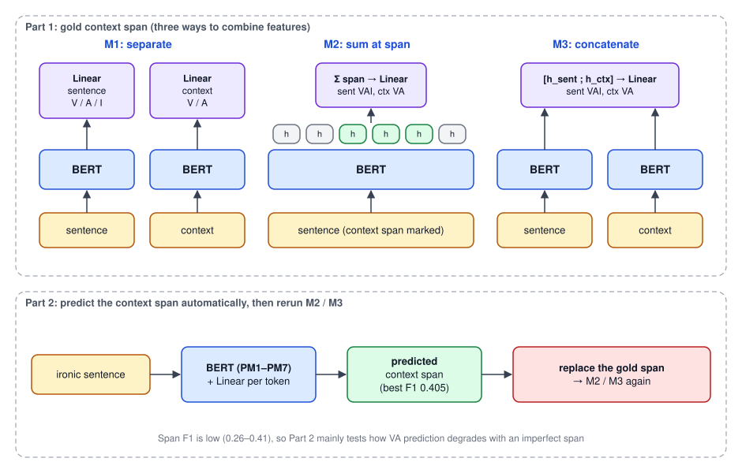

## 論文資訊

| 項目 | 內容 |
|---|---|
| 發表 | International Journal of Computational Linguistics & Chinese Language Processing（IJCLCLP）Vol. 27, No. 2, pp. 73–88, 2022 年 12 月 |
| 作者 | Jheng-Long Wu, Sheng-Wei Huang, **Wei-Yi Chung**, Yu-Hsuan Wu, Chen-Chia Yu |
| 連結 | [ACL Anthology](https://aclanthology.org/2022.ijclclp-2.5/) · [PDF](https://aclanthology.org/2022.ijclclp-2.5.pdf) |
| 程式碼 | 沒有公開 repo |
| 研討會版 | [A Dimensional Valence-Arousal-Irony Dataset for Chinese Sentence and Context]()（ROCLING 2022） |
| 經費 | 科技部計畫 MOST 110-2221-E-031-004、MOST 111-2221-E-031-004-MY3 |

## 和研討會版的差別

資料集一樣是 CDVAI（1,004 句反諷句、843 段反諷語境），標註規範、標註者一致性和分數分布都和 [ROCLING 版]()相同，這裡不重複。期刊版的新東西在模型實驗：

| | ROCLING 2022 | IJCLCLP 2022 |
|---|---|---|
| M1/M2/M3 用在哪 | 只有語境層級的 VA | **句子層級的 VAI 和語境層級的 VA 都用** |
| 預訓練模型 | 4 個中文 + 2 個多語 | **6 個中文**（換成 MacBERT、RoBERTa 和三個 Erlangshen 模型） |
| 語境位置 | 用人工標註的位置 | 另外訓練模型**自動預測語境位置**，再用預測結果重跑 |
| 主要結論 | M3 對語境 Arousal 有幫助 | M2/M3 對語境層級幫助很大；語境位置要準才有用 |

論文也把反諷偵測明確定位成**情緒偵測問題**：反諷在對話裡有幽默效果，會帶出特定的情緒模式，所以除了「是不是反諷」，更該看反諷時的 Valence 和 Arousal。

## 模型架構

實驗分成兩部分。

### 第一部分：用人工標註的語境位置

用預訓練 BERT 當編碼器取出隱藏特徵，再接一層 Linear 預測分數。三種組合句子與語境特徵的方式：

| 方法 | 做法 |
|---|---|
| M1 | 句子和語境各自進編碼器。句子的特徵預測句子的 VAI，語境的特徵預測語境的 VA，兩邊互不相干 |
| M2 | 語境在句子中的位置已經標好。整句進編碼器後，把語境位置上的隱藏向量**加總**，再用它預測句子 VAI 和語境 VA |
| M3 | 句子和語境各自進編碼器，把兩個隱藏向量**串接**起來，再預測句子 VAI 和語境 VA |

M1 是基準；M2 想知道「只看語境那一段」夠不夠；M3 想知道「同時給整句和語境」能不能讓模型看出兩者之間的情緒反差。

### 第二部分：自動預測語境位置

實際應用時不會有人幫你標好語境在哪，所以第二部分訓練一個**語境片段預測模型**：BERT 編碼後，每個 token 接 Linear，判斷它是不是語境的一部分。

接著用預測出來的片段取代人工標註的片段，把第一部分的 M2、M3 再跑一次，看語境位置不準的時候，VA 預測會變差多少。

## 實驗設定

資料切分沿用 ROCLING 版：分層抽樣，訓練與測試 7:3，再從訓練集切 1/10 當驗證集（句子層級 632 / 71 / 301 句，語境層級 531 / 59 / 253 句）。

| 參數 | 值 |
|---|---|
| Optimizer | Adam |
| 學習率（句子層級） | 4e-4、4e-5、4e-6 |
| 學習率（語境層級） | 4e-5、4e-6、4e-7 |
| 學習率（語境片段預測） | 論文表格列為 43e-6、45e-6 |
| Epoch | 50 |

語境的資訊比整句少，片段預測又更難學，所以這兩者都試比較小的學習率。

**比較的預訓練模型**（全部是中文模型）：

| 代號 | 模型 | 說明 |
|---|---|---|
| PM1 | hfl/chinese-macbert-base | 簡體與繁體中文維基 |
| PM2 | shibing624/macbert4csc-base-chinese | 用 SIGHAN 錯字更正語料訓練 |
| PM3 | uer/chinese_roberta_L-4_H-256 | UER 工具包 + CLUECorpus2020，4 層的小模型 |
| PM4 | IDEA-CCNL/Erlangshen-Ubert-110M-Chinese | 多種任務資料訓練的 UBERT |
| PM5 | IDEA-CCNL/Erlangshen-Ubert-330M-Chinese | 同上，較大的版本 |
| PM6 | IDEA-CCNL/Erlangshen-UniMC-RoBERTa-110M-Chinese | 用 13 個監督式資料集訓練 |
| PM7 | IDEA-CCNL/Erlangshen-DeBERTa-v2-97M-Chinese | 只用在第二部分的片段預測 |

## 第一部分結果

### 句子層級 VAI（MAE，越低越好）

粗體是各指標的最低值。

| 模型 | V-M1 | V-M2 | V-M3 | A-M1 | A-M2 | A-M3 | I-M1 | I-M2 | I-M3 |
|---|---|---|---|---|---|---|---|---|---|
| PM1 | **0.346** | 0.421 | 0.390 | **0.521** | 0.649 | 0.639 | **0.521** | 0.577 | 0.603 |
| PM2 | 0.380 | 0.421 | 0.390 | 0.619 | 0.649 | 0.639 | 0.601 | 0.577 | 0.603 |
| PM3 | 0.371 | 0.410 | 0.371 | 0.643 | 0.603 | 0.596 | 0.538 | 0.570 | 0.566 |
| PM4 | 0.380 | 0.412 | 0.390 | 0.619 | 0.614 | 0.639 | 0.601 | 0.572 | 0.603 |
| PM5 | 0.376 | 0.381 | 0.420 | 0.615 | 0.616 | 0.610 | 0.575 | 0.591 | 0.559 |
| PM6 | 0.380 | 0.412 | 0.390 | 0.619 | 0.614 | 0.639 | 0.601 | 0.577 | 0.603 |

- **Valence**：MAE 都在 0.4 左右，而且 **M1 最好**。論文認為 Valence 本來就好判斷，額外塞進更複雜的特徵反而變差。
- **Arousal**：MAE 約 0.6，比 Valence 難。這裡 M1 不一定最好，PM3～PM6 用 M2 或 M3 都有進步。
- **Irony**：MAE 約 0.5～0.6，比 Arousal 好一點，代表用「關鍵字和語境的落差」來給分的標註方式是有效的。PM2、PM4、PM5、PM6 用 M2、M3 會進步。
- 整體來說，句子層級表現不錯，但 **M2、M3 對句子層級沒有明顯幫助**。

### 語境層級 VA（MAE）

粗體是每個模型在該指標上最好的方法。

| 模型 | V-M1 | V-M2 | V-M3 | A-M1 | A-M2 | A-M3 |
|---|---|---|---|---|---|---|
| PM1 | 0.431 | 0.408 | **0.389** | 0.819 | **0.649** | 0.787 |
| PM2 | 0.413 | 0.408 | **0.389** | 0.796 | **0.649** | 0.787 |
| PM3 | 0.431 | 0.468 | **0.427** | 0.798 | **0.603** | 0.829 |
| PM4 | 0.413 | 0.415 | **0.389** | 0.796 | **0.614** | 0.787 |
| PM5 | **0.426** | 0.463 | 0.428 | 0.815 | **0.616** | 0.834 |
| PM6 | 0.413 | 0.415 | **0.389** | 0.796 | **0.614** | 0.787 |

這裡的結果和句子層級完全不同：

- **Valence**：6 個模型中有 5 個是 M3 最好，最低降到 0.389。
- **Arousal**：M2 大幅領先，MAE 從 M1 的 0.8 左右**降到 0.6 左右**。論文的解讀是：判斷語境有多激動時，語境本身的資訊比整句更重要。
- 結論是：**要理解反諷語境的真正情緒，必須把語境和整句結合起來看**。這也呼應了 CDVAI 要把語境分開標註的初衷。

## 第二部分結果

### 語境片段預測

| 模型 | Precision | Recall | F1 |
|---|---|---|---|
| PM1 | 0.373 | 0.302 | 0.333 |
| PM2 | 0.349 | 0.274 | 0.307 |
| PM3 | 0.329 | 0.218 | 0.262 |
| PM4 | 0.373 | 0.309 | 0.331 |
| PM5 | 0.436 | 0.352 | 0.390 |
| PM6 | 0.373 | 0.298 | 0.338 |
| PM7 | **0.438** | **0.377** | **0.405** |

PM1～PM6 的表現都不理想，所以論文加入 PM7（DeBERTa-v2），F1 最高也只有 0.405。找出反諷語境的邊界本身就是一個困難的任務。

### 用預測的片段重跑 M2 / M3

接下來用 PM7 預測的片段取代人工標註，再跑一次。

**句子層級**

| 模型 | V-M2 | V-M3 | A-M2 | A-M3 | I-M2 | I-M3 |
|---|---|---|---|---|---|---|
| PM1 | 0.337 | 0.403 | 0.631 | 0.585 | 0.575 | 0.638 |
| PM2 | 0.337 | 0.403 | 0.631 | 0.585 | 0.575 | 0.638 |
| PM3 | 0.384 | 0.376 | 0.618 | 0.648 | 0.606 | 0.613 |
| PM4 | 0.392 | 0.403 | 0.677 | 0.585 | 0.594 | 0.638 |
| PM5 | 0.383 | 0.364 | 0.607 | 0.609 | 0.561 | 0.574 |
| PM6 | 0.392 | 0.403 | 0.677 | 0.585 | 0.594 | 0.638 |

- 句子 Valence 用 M2 反而**變好**（PM1 從 0.421 降到 0.337）。論文推測：預測的片段雖然不準，卻剛好包含更多情緒詞。
- Arousal 和 Irony 的變化有好有壞，例如 Arousal 的 M3 在 PM1 從 0.639 降到 0.585，在 PM3 卻從 0.596 升到 0.648。

這是一個有意思的發現：**對句子層級來說，重要的可能不是完整的語境，而是語境裡關鍵的幾個字**。

**語境層級**

| 模型 | V-M2 | V-M3 | A-M2 | A-M3 |
|---|---|---|---|---|
| PM1 | 0.419 | 0.447 | 0.819 | 0.824 |
| PM2 | 0.419 | 0.447 | 0.819 | 0.824 |
| PM3 | 0.471 | 0.436 | 0.867 | 0.810 |
| PM4 | 0.435 | 0.447 | 0.844 | 0.824 |
| PM5 | 0.442 | 0.451 | 0.801 | 0.844 |
| PM6 | 0.435 | 0.447 | 0.844 | 0.824 |

語境層級就沒那麼幸運了。和第一部分相比，Valence 差不多，但 Arousal 的 M2 從 0.60～0.65 **退回 0.80～0.87**，第一部分 M2 帶來的進步幾乎全部消失。這說明語境情緒很依賴**正確的語境片段**：片段一錯，模型就學不到語境本身的激動程度。

## 錯誤分析

論文用第一部分表現不錯的 PM3 看一個錯誤案例：

> 「很好……連喇叭都壞了 X-(」，語境是「連喇叭都壞了」

| | 句子 V | 句子 A | 句子 I | 語境 V | 語境 A |
|---|---|---|---|---|---|
| 標註 | 2 | 3 | 1 | 2 | 3 |
| 預測 | 1.71 | 3.45 | 1.94 | 1.63 | 1.97 |

- 模型把「連」、「壞了」當成強烈的負面詞，Valence 判得太低；但喇叭壞掉通常不會讓人那麼生氣，模型缺乏這種常識。
- Irony 偏高：模型看到「很好」和負面語境之間的落差就給了高分，但這句沒有其他加強反諷的片段，標註分數其實很低。

## 結論與限制

1. **句子層級**：M2、M3 沒有明顯幫助；但第二部分顯示，語境裡的關鍵詞可能比完整語境更有用。
2. **語境層級**：M2、M3 明顯進步，代表反諷語境的情緒要結合整句才看得懂。
3. **語境位置要準**：自動預測的片段 F1 只有 0.405，用它取代人工標註後，語境 Arousal 的進步就消失了。

限制和 ROCLING 版一樣：資料量小，也沒有涵蓋完整的反諷句型，適合當作擴充樣本或標註規範的起點。片段預測模型本身也還有很大的改進空間。
