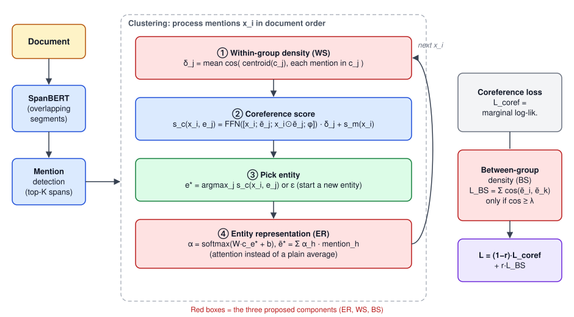

## Paper Info

| Item | Details |
|---|---|
| Type | Master's thesis, School of Big Data Management, Soochow University |
| Title | 基於實體表徵學習與密度估計於指代消解 (Entity Representation Learning and Density Estimation for Coreference Resolution) |
| Author | **Wei-Yi Chung** (advisor: Jheng-Long Wu) |
| Dataset | OntoNotes 5.0 / CoNLL-2012 |
| Code | Not on GitHub (the `e2e-coref` repo on my GitHub is an unmodified fork of the original authors' code) |

## What Coreference Resolution Is

Coreference resolution finds every mention in a document that refers to the same entity. In the cover image, "Prime Minister Junichiro Koizumi" and the later "Koizumi" are the same person, and "Japan" and "itself" are the same country. It is often a preprocessing step for information retrieval and stance analysis.

## Motivation

Current models score a new **mention** against existing **entities** during inference, so the quality of the entity representation matters a lot. Prior work usually takes the **centroid** of all mention representations in an entity, which has problems:

- Mentions are not equally representative. Pronouns such as "you", "I", and "he" carry little information, and averaging dilutes the important mentions.
- If a mention is clustered wrongly during inference, the averaged entity representation drifts more easily.
- Mentions in the same entity all corefer, so their representations should have **high within-group density**, and different entities should have **low between-group density**. Prior work did not model this directly.

## Model Architecture

The baseline is the open-source long-document coreference model of Toshniwal et al. (2020). It has two stages; the red boxes are the three components this thesis adds.

### Stage 1: Mention Detection

1. **Document encoding**: SpanBERT pre-trained on OntoNotes encodes the document. Long documents exceed the length limit T, so a segment of length T starts every T/2 tokens; segments overlap by half, and each token's final representation is a weighted mix of its two segments.
2. **Candidate mentions**: every span up to length L is a candidate with mention score `s_m`; the top 0.4 × document length spans are kept. Mention detection is first fine-tuned on gold mentions, otherwise almost every early candidate is invalid and clustering gets no useful signal.

### Stage 2: Clustering Mentions in Order

The model walks through candidate mentions `x_i` in document order and keeps a list of entities so far:

1. **Within-group density (WS, proposed)**: for each entity `e_j`, average the cosine similarity between each mention and the entity centroid to get `δ_j`. High density means a tight, trustworthy cluster; low density suggests a wrongly added mention.
2. **Coreference score**: a feed-forward network scores the new mention against each entity from the mention representation, the entity representation, their element-wise product, and feature embeddings (mention count in the entity, distance to its last mention, mention type). The score is **multiplied by `δ_j`**, so a suspicious entity is less likely to absorb more mentions and errors do not snowball.
3. **Pick an entity**: take the highest-scoring entity `e*` and add `x_i` to it, or output ε to start a new entity if nothing matches.
4. **Entity representation (ER, proposed)**: only `e*` changed, so only its representation is updated. Instead of averaging, soft attention weights each mention: `α = softmax(W·c_e* + b)`, `ẽ* = Σ α_h · mention_h`. Pronouns and wrongly clustered mentions get low weights, so the entity representation does not drift.

### Training Objective

- **Coreference loss**: for each mention, softmax over all candidate entities (including ε) and maximize the marginal likelihood of the gold cluster.
- **Between-group density loss (BS, proposed)**: compare every pair of entity representations by cosine similarity and only count pairs above threshold λ, pushing confusable entities apart; pairs below λ produce no gradient.
- The total loss is `L = (1 − r)·L_coref + r·L_BS`, with r the weight of the density loss. Mention detection and inference train end to end and share SpanBERT's parameters.

### Other Ways to Estimate the Entity Representation

The soft attention above is the version described in the method chapter. The experiments also compare four other ways to update the entity representation:

| Method | How it works |
|---|---|
| Original | Baseline: average all mention representations in the entity |
| Weighted | Concatenate the entity representation and new mention, pass through a linear layer + sigmoid to get a weight `w`, and update to `w·ẽ + (1−w)·x` |
| Attention | The soft attention above: weight every mention and sum |
| LSTM | Feed the new mention through an LSTM cell; the hidden state is the entity representation and the cell state is its memory |
| Encoder | Pass all mentions of the entity through a Transformer encoder layer to produce the new entity representation |

Within-group density also has two variants: Cosine (as above) and MSE (`δ_j = 1 − mean squared error`, where each mention is compared with the cluster mean).

## Experimental Setup

### Data

English OntoNotes, converted to CoNLL-2012 format following Joshi et al. (2019) (sentences, mention start/end, speaker, coreference clusters, subtokens), with their standard split:

| Split | Documents | Avg. words | Avg. sentences |
|---|---|---|---|
| Train | 2,802 | 463 | 26 |
| Validation | 343 | 474 | 27 |
| Test | 348 | 486 | 26 |

A few properties of the data matter a lot:

- Very few documents have more than 40 entities; most test documents have 15 or fewer.
- Most entities have **3 or fewer mentions**, often a single coreferent pair, and entities with more than 10 mentions are rare. **Getting small clusters right** therefore decides overall performance.
- The dataset **has no singleton annotations**.

### Nine Models

| Model | Components |
|---|---|
| COREF_BASE | Reproduction of Toshniwal et al. (2020)'s open-source model, used as the baseline |
| COREF_LM | Uses the entity's **last mention** as its representation, original parameters otherwise |
| COREF_ER | Baseline + entity representation estimation |
| COREF_WS | Baseline + within-group density |
| COREF_BS | Baseline + between-group density loss |
| COREF_ERWS | ER + WS (both act on the coreference score) |
| COREF_ERBS | ER + BS (compare with ERWS to contrast within- and between-group density) |
| COREF_WSBS | WS + BS (one local, one global) |
| COREF_ERWSBS | All three components |

### Parameters

| Parameter | Setting |
|---|---|
| Entity representation ER | Encoder, LSTM, Attention, Weighted, Original |
| Within-group density WS | Cosine, MSE |
| Between-group density BS | Cosine |
| Threshold λ | 0.1–0.9, plus a learned threshold (`λ = sigmoid(Linear(mean(ẽ)))`) |
| Loss ratio r | sum (plain addition), 0.1, 0.5 |
| Epochs | 30 |
| Learning rate | 2e-4 |
| Dropout | 0.3 |

Implemented in PyTorch and trained on GPU. The metric is the CoNLL standard: the average F1 of MUC, B³ and CEAFφ4.

## Results

### 1. The nine models (test set)

| Model | MUC | B³ | CEAFφ4 | Avg. F1 |
|---|---|---|---|---|
| COREF_BASE | 84.6 | 76.9 | 73.5 | 78.3 |
| COREF_LM | 84.4 | 76.3 | 73.2 | 78.0 |
| COREF_ER | 84.9 | 77.2 | 74.8 | 79.0 |
| COREF_WS | 84.9 | 77.5 | 74.1 | 78.8 |
| COREF_BS | 84.9 | 77.3 | 74.0 | 78.7 |
| COREF_ERWS | 84.9 | 77.3 | **75.0** | 79.1 |
| COREF_ERBS | 84.9 | 77.1 | 74.7 | 79.0 |
| COREF_WSBS | **85.1** | 77.5 | 74.3 | 79.0 |
| COREF_ERWSBS | **85.1** | **77.6** | 74.8 | **79.2** |

- **The baseline did not reproduce**: the original paper reports 79.6 F1, but my best over many independent reruns was 78.3, so every improvement is measured against the reproduced 78.3.
- **Last mention alone already gets 78.0**: the most recent mention is strongly tied to a new one, but once that last mention is misclustered the error propagates.
- **Each single component helps**, ER the most (79.0).
- **Every pair reaches 79+**, and the full COREF_ERWSBS is best on test (79.2), **+0.9 F1** over the baseline. Its validation score (79.2) is a bit below ERWS's 79.4, but its validation and test scores agree, so it is more stable.

### 2. Against contemporary models (test set)

| Model | MUC P | MUC R | MUC F1 | B³ P | B³ R | B³ F1 | CEAF P | CEAF R | CEAF F1 | Avg. F1 |
|---|---|---|---|---|---|---|---|---|---|---|
| SpanBERT (Joshi et al., 2020) | 85.8 | 84.8 | 85.3 | 78.3 | 77.9 | 78.1 | 76.4 | 74.2 | 75.3 | **79.6** |
| U-MEM (Toshniwal et al., 2020) | 85.5 | 85.1 | 85.3 | 78.7 | 77.3 | 78.0 | 74.2 | 76.5 | 75.3 | **79.6** |
| BERT-large + c2f-coref (Joshi et al., 2019) | 84.7 | 82.4 | 83.5 | 76.5 | 74.0 | 75.3 | 74.1 | 69.8 | 71.9 | 76.9 |
| EE (Kantor & Globerson, 2019) | 82.6 | 84.1 | 83.4 | 73.3 | 76.2 | 74.7 | 72.4 | 71.1 | 71.8 | 76.6 |
| Fei et al. (2019) | 85.4 | 77.9 | 81.4 | 77.9 | 66.4 | 71.7 | 70.6 | 66.3 | 68.4 | 73.8 |
| c2f-coref (Lee et al., 2018) | 81.4 | 79.5 | 80.4 | 72.2 | 69.5 | 70.8 | 68.2 | 67.1 | 67.6 | 73.0 |
| COREF_BASE (reproduced) | 85.5 | 83.8 | 84.6 | 78.2 | 75.6 | 76.9 | 75.8 | 71.3 | 73.5 | 78.3 |
| **COREF_ERWSBS** | **86.2** | 84.0 | 85.1 | **79.2** | 76.0 | 77.6 | **76.6** | 73.0 | 74.8 | 79.2 |

Average F1 does not beat the state of the art, but **the MUC, B³ and CEAF precisions are the highest of all models**. The components make the model pick entities more cautiously: when it is not confident, it starts a new entity instead, so precision rises and recall pays for it. The components add only about 0.8M parameters to roughly 40M, about 2%.

### 3. Entity representation methods (COREF_ER, test set)

| Method | MUC | B³ | CEAFφ4 | Avg. F1 |
|---|---|---|---|---|
| **Encoder** | 84.9 | 77.2 | **74.8** | **79.0** |
| LSTM | **85.0** | 77.1 | 74.4 | 78.8 |
| Attention | 84.8 | **77.3** | 73.6 | 78.6 |
| Weighted | 84.7 | 77.1 | 73.2 | 78.3 |
| Original (mean) | 84.6 | 76.9 | 73.5 | 78.3 |

COREF_ER's 79.0 is the Encoder version.

- **Encoder is best**: multi-head self-attention captures how every mention relates to every other, independent of order, so it uses all of the entity's information.
- **LSTM is second**: a sequence model emphasises nearby mentions, and the distance between two mentions is strongly tied to whether they corefer.
- **Attention third, Weighted and mean last**: methods that *regenerate* the entity representation with a network (Encoder, LSTM) beat methods that compute weights and multiply them back onto the original mentions (Attention, Weighted).

### 4. Within-group density (COREF_WS, test set)

| Method | MUC | B³ | CEAFφ4 | Avg. F1 |
|---|---|---|---|---|
| **Cosine** | **84.9** | **77.5** | **74.1** | **78.8** |
| MSE | 84.7 | 77.1 | 74.0 | 78.6 |

Cosine wins on every metric. The reason is range: SpanBERT's outputs pass through tanh into −1 to 1, so MSE puts `δ_j` anywhere in 0 to 4. Multiplying that into the coreference score adjusts it too aggressively, which makes cluster differences harder to learn and enlarges errors when the prediction is wrong.

### 5. Between-group threshold λ and ratio r (COREF_BS, test set)

**λ (r fixed at 0.1)**

| λ | 0.1 | 0.2 | 0.3 | 0.4 | 0.5 | 0.6 | 0.7 | **0.8** | 0.9 | Learned |
|---|---|---|---|---|---|---|---|---|---|---|
| Avg. F1 | 77.4 | 77.4 | 77.7 | 78.1 | 78.2 | 78.6 | 78.4 | **78.7** | 78.2 | 78.0 |

- Higher λ is mostly better; 0.8 is best and 0.9 drops.
- At λ ≤ 0.3 (push apart anything with similarity above 0.3) F1 stays below 78: the model updates many entities that are already spread out enough.
- Only around 0.6 and above does it pick the entities that actually get confused; few entity pairs exceed 0.9 similarity, so 0.9 drops again.
- The learned threshold converges to 0.42 and performs like a fixed 0.4, so a learned threshold struggles to reach the optimum.

**r (λ fixed at 0.8)**

| r | sum | **0.1** | 0.5 |
|---|---|---|---|
| Avg. F1 | 78.5 | **78.7** | 78.6 |

The between-group loss is auxiliary, and the coreference loss should dominate. r = 0.1 works best; sum or 0.5 weight both losses equally, so convergence no longer focuses on coreference.

### 6. Ablation and significance

| Model | Avg. F1 | Δ |
|---|---|---|
| COREF_BASE | 78.3 | — |
| + Entity representation ER | 79.0 | **+0.7** |
| + Within-group density WS | 78.8 | +0.5 |
| + Between-group density BS | 78.7 | +0.4 |

- **ER contributes most**: inference scores mentions against entity representations, so a more representative entity means better coreference scores, and it also makes the between-group density estimate more accurate.
- **WS** lowers the score of low-density entities, so new mentions stop flowing into a wrong entity.
- **BS** widens the margin between entity representations so coreference scores separate better.

Because the prediction distributions differ, pairwise **two-sided independent two-sample t-tests** compare the F1 of BASE, ER, WS and BS. All p-values fall between 0.027 and 0.047, below 0.05, so each component contributes significantly and in a different way.

### 7. How entity representations move during training

Entity representations from COREF_BS (λ = 0.8) are projected to 2-D with PCA:

- **A document with few entities** (3): mentions are already far apart, and the entity representations barely move between epoch 1 and epoch 15. Their density is already low, so the between-group loss leaves them alone.
- **A document with many entities** (8): mentions of the same entity are not very concentrated, so an unrepresentative entity representation easily causes errors. During training:
  - Two entities overlap through epochs 1–5 and are pushed apart from epoch 7 on.
  - Two others briefly overlap at epoch 9 (possibly from a misclustered or similar mention); their high similarity makes them targets for the update, and they separate again by epoch 11.
  - By epoch 15 every entity stands apart, density between entities is low, and the between-group loss stops firing.

### 8. Error analysis

Looking at precision and recall per metric shows each component's "personality":

- **MUC**: ER, WS and ERWS have higher recall (84.8, 85.1, 84.8). Components that act on the coreference score link more correct pairs but also merge some mentions that should start new entities, so precision dips slightly. All four models with BS reach precision of 85.5 or more, because once entities are pushed apart, choosing one is more precise.
- **B³**: models with density estimation all reach precision above 78. More spread-out entities make small clusters, even singletons, more likely, which raises precision; within-group density raises coreference scores and therefore recall.
- **CEAFφ4**: WSBS and ERWSBS, which have both within- and between-group density, reach precisions of 77.2 and 77.6; ERWS, whose within-group density tends to build larger clusters, reaches recall of 74.9.

Each component stands out on different metrics, and combining them lifts every metric, so the components interact positively.

## Conclusion and Limitations

**Contributions**:

- Entity representation estimation lets the model decide how representative each mention is, so pronouns and misclustered mentions do not drag the entity off course.
- Within-group density adjusts coreference scores to stop errors from snowballing; the between-group loss pushes different entities apart.
- Together they add about 0.9 F1 over the reproduced baseline, with the highest precision on all three metrics among the compared models.
- The entity-estimation idea extends to other group-based tasks such as clustering and named entities, and coreference itself is a preprocessing step for stance detection and sentiment analysis.

**Limitations**:

- The baseline could not be reproduced to its reported 79.6, so improvements build on the reproduced 78.3.
- OntoNotes does not annotate singletons, so singleton performance cannot be evaluated.

**Future work**: an entity-representation estimator that balances accuracy and compute; other similarity measures such as LSA or PMI for within-group density; and using the model as preprocessing for other NLP tasks.

## Local Archive

`Project/2021Q2 碩士論文/` keeps every draft of the first three chapters, the seminar-course version, the defense slides, the final PDFs (color and black-and-white), and the forms for the defense application and graduation.
