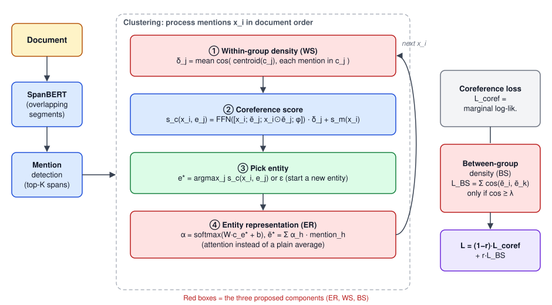

## 論文資訊

| 項目 | 內容 |
|---|---|
| 類型 | 碩士論文，東吳大學巨量資料管理學院 |
| 題目 | 基於實體表徵學習與密度估計於指代消解 |
| 作者 | **鍾崴亦**（指導教授：吳政隆） |
| 資料集 | OntoNotes 5.0 / CoNLL-2012 |
| 程式碼 | 沒有放上 GitHub（GitHub 上的 `e2e-coref` 只是 fork 原作者的 repo，沒有我的修改） |

## 什麼是指代消解

指代消解（Coreference Resolution）要找出文章裡指向同一個實體的所有提及（mention）。例如封面圖中，「Prime Minister Junichiro Koizumi」和後面的「Koizumi」是同一個人，「Japan」和「itself」是同一個國家。它常被當作資訊檢索、立場分析等任務的前處理。

## 研究動機

目前主流模型在推論時，是拿**實體**跟新的**提及**計算共指分數，所以實體表徵的品質影響很大。過去研究常直接用同一實體內所有提及表徵的**中心**當作實體表徵，問題是：

- 不同提及的代表性不同。「你、我、他」這類代名詞資訊量低，取平均會稀釋掉重要的提及。
- 推論過程中如果有提及被分錯群，平均後的實體表徵更容易被帶偏。
- 同一實體內的提及都共指，表徵應該**群內密度高**；不同實體之間則應該**群間密度低**。過去研究沒有直接處理這層關係。

## 模型架構

以 Toshniwal et al. (2020) 開源的長文件指代消解模型為基線，分成兩個階段，紅框是這篇論文加上去的三個組件。

### 第一階段：提及檢測

1. **文件編碼**：用在 OntoNotes 上預訓練好的 SpanBERT 編碼文件。長文件超過模型長度上限 T，所以每隔 T/2 個 token 切一段長度 T 的片段，片段之間重疊一半，最後的 token 表徵由兩個重疊片段加權得到。
2. **挑選潛在提及**：把長度 L 以內的所有跨度（span）都當作候選，算出提及分數 `s_m`，保留分數最高的 0.4 × 文件長度個跨度。訓練時會先用正解微調提及檢測，不然一開始挑出的幾乎都是無效跨度，後面的聚類學不到東西。

### 第二階段：依序聚類提及

模型照文件順序一個一個處理潛在提及 `x_i`，維護目前已有的實體清單：

1. **群內密度（WS，本文組件）**：對每個實體 `e_j`，算出裡面每個提及和實體中心的 cosine 相似度並取平均，得到 `δ_j`。密度高代表這群提及很集中、比較可信；密度低則代表裡面可能混進了分錯的提及。
2. **共指分數**：用前饋網路計算新提及和每個實體的分數，輸入包含提及表徵、實體表徵、兩者的點乘，以及特徵嵌入（實體裡有幾個提及、和最後一個提及隔多遠、提及類型）。分數**乘上 `δ_j`**，讓可疑的實體比較不容易再吸收新的提及，避免錯誤一路擴大。
3. **挑選實體**：取分數最高的實體 `e*`，把 `x_i` 加進去；如果和所有實體都不相關，就輸出 ε，自己開一個新實體。
4. **實體表徵估計（ER，本文組件）**：只有 `e*` 改變，所以只更新它的表徵。不是取平均，而是用 soft attention 給實體裡每個提及一個權重：`α = softmax(W·c_e* + b)`，`ẽ* = Σ α_h · mention_h`。代名詞或分錯的提及會被分到比較低的權重，實體表徵就比較不會偏掉。

### 訓練目標

- **指代誤差**：對每個提及，在所有候選實體（含 ε）上做 softmax，最大化正解群組的邊際似然。
- **群間密度誤差（BS，本文組件）**：兩兩比較實體表徵的 cosine 相似度，只有超過閾值 λ 的才計入誤差，把容易混淆的實體推開；低於 λ 的不產生梯度。
- 整體誤差為 `L = (1 − r)·L_coref + r·L_BS`，r 是群間密度誤差的比例。提及檢測和推論端到端一起訓練，並共用 SpanBERT 的參數。

### 實體表徵的其他估計方式

上面的 soft attention 是方法章節描述的版本。實驗時另外比較了四種更新實體表徵的方式：

| 方法 | 做法 |
|---|---|
| Original | 基線做法：實體內所有提及表徵取平均 |
| Weighted | 把實體表徵和新提及串接，經過線性層 + sigmoid 得到權重 `w`，更新為 `w·ẽ + (1−w)·x` |
| Attention | 上面的 soft attention，對每個提及算權重後加權相加 |
| LSTM | 用 LSTM Cell 把新提及併入，hidden state 當實體表徵、cell state 當記憶 |
| Encoder | 把實體內所有提及丟進一層 Transformer Encoder，輸出新的實體表徵 |

群內密度同樣比較了兩種算法：Cosine（公式如上）和 MSE（`δ_j = 1 − 平均平方誤差`，每個提及減去群內平均後取平方）。

## 實驗設定

### 資料

OntoNotes 英文資料，依 Joshi et al. (2019) 的方法轉成 CoNLL-2012 格式（句子、提及起訖位置、說話者、共指群組、subtoken），並沿用其切分：

| 切分 | 文件數 | 平均字數 | 平均句數 |
|---|---|---|---|
| 訓練 | 2,802 | 463 | 26 |
| 驗證 | 343 | 474 | 27 |
| 測試 | 348 | 486 | 26 |

幾個資料特性影響很大：

- 超過 40 個實體的文章非常少；測試集大多在 15 個實體以內。
- 絕大多數實體只有 **3 個以下的提及**，很多是一對一的共指對，超過 10 個提及的實體很少。所以**小群組能不能分對**，對整體表現有決定性的影響。
- 資料集**不含單例（singleton）**。

### 九種模型

| 模型 | 組成 |
|---|---|
| COREF_BASE | 重現 Toshniwal et al. (2020) 的開源模型，作為基線 |
| COREF_LM | 用實體內**最後一個提及**當實體表徵，其他照原始參數 |
| COREF_ER | 基線 + 實體表徵估計 |
| COREF_WS | 基線 + 群內密度 |
| COREF_BS | 基線 + 群間密度誤差 |
| COREF_ERWS | ER + WS（兩個都作用在共指分數上） |
| COREF_ERBS | ER + BS（可以和 ERWS 比較群內、群間密度的差異） |
| COREF_WSBS | WS + BS（一個管局部、一個管全域） |
| COREF_ERWSBS | 三個組件全加 |

### 參數

| 參數 | 設定 |
|---|---|
| 實體表徵 ER | Encoder、LSTM、Attention、Weighted、Original |
| 群內密度 WS | Cosine、MSE |
| 群間密度 BS | Cosine |
| 閾值 λ | 0.1–0.9，以及用神經網路學出來的 Learned（`λ = sigmoid(Linear(mean(ẽ)))`） |
| 誤差比例 r | sum（直接相加）、0.1、0.5 |
| Epoch | 30 |
| Learning rate | 2e-4 |
| Dropout | 0.3 |

用 PyTorch 實作、GPU 訓練。評估指標是 CoNLL 標準的 MUC、B³、CEAFφ4 三個 F1 的平均。

## 實驗結果

### 一、九種模型的表現（測試集）

| 模型 | MUC | B³ | CEAFφ4 | 平均 F1 |
|---|---|---|---|---|
| COREF_BASE | 84.6 | 76.9 | 73.5 | 78.3 |
| COREF_LM | 84.4 | 76.3 | 73.2 | 78.0 |
| COREF_ER | 84.9 | 77.2 | 74.8 | 79.0 |
| COREF_WS | 84.9 | 77.5 | 74.1 | 78.8 |
| COREF_BS | 84.9 | 77.3 | 74.0 | 78.7 |
| COREF_ERWS | 84.9 | 77.3 | **75.0** | 79.1 |
| COREF_ERBS | 84.9 | 77.1 | 74.7 | 79.0 |
| COREF_WSBS | **85.1** | 77.5 | 74.3 | 79.0 |
| COREF_ERWSBS | **85.1** | **77.6** | 74.8 | **79.2** |

- **基線重現不到原論文**：原論文報告 79.6 F1，我多次獨立重跑後最好只有 78.3，所以後面的改良都和重現的 78.3 比較。
- **只用最後一個提及也有 78.0**：代表最近的提及和新提及關聯很高，但一旦最後一個提及分錯，就會一路錯下去。
- **單一組件都有幫助**，其中 ER 最多（79.0）。
- **兩兩組合都到 79 以上**，三個全加的 COREF_ERWSBS 在測試集最好（79.2），比基線**提升 0.9 F1**。它在驗證集（79.2）略低於 ERWS 的 79.4，但驗證和測試表現一致，比較穩定。

### 二、和當時主流模型比較（測試集）

| 模型 | MUC P | MUC R | MUC F1 | B³ P | B³ R | B³ F1 | CEAF P | CEAF R | CEAF F1 | 平均 F1 |
|---|---|---|---|---|---|---|---|---|---|---|
| SpanBERT (Joshi et al., 2020) | 85.8 | 84.8 | 85.3 | 78.3 | 77.9 | 78.1 | 76.4 | 74.2 | 75.3 | **79.6** |
| U-MEM (Toshniwal et al., 2020) | 85.5 | 85.1 | 85.3 | 78.7 | 77.3 | 78.0 | 74.2 | 76.5 | 75.3 | **79.6** |
| BERT-large + c2f-coref (Joshi et al., 2019) | 84.7 | 82.4 | 83.5 | 76.5 | 74.0 | 75.3 | 74.1 | 69.8 | 71.9 | 76.9 |
| EE (Kantor & Globerson, 2019) | 82.6 | 84.1 | 83.4 | 73.3 | 76.2 | 74.7 | 72.4 | 71.1 | 71.8 | 76.6 |
| Fei et al. (2019) | 85.4 | 77.9 | 81.4 | 77.9 | 66.4 | 71.7 | 70.6 | 66.3 | 68.4 | 73.8 |
| c2f-coref (Lee et al., 2018) | 81.4 | 79.5 | 80.4 | 72.2 | 69.5 | 70.8 | 68.2 | 67.1 | 67.6 | 73.0 |
| COREF_BASE（重現） | 85.5 | 83.8 | 84.6 | 78.2 | 75.6 | 76.9 | 75.8 | 71.3 | 73.5 | 78.3 |
| **COREF_ERWSBS** | **86.2** | 84.0 | 85.1 | **79.2** | 76.0 | 77.6 | **76.6** | 73.0 | 74.8 | 79.2 |

平均 F1 沒有超過 SOTA，但 **MUC、B³、CEAF 三個 Precision 都是所有模型裡最高的**。三個組件讓模型更謹慎地選實體，共指把握度不夠時寧可自己開一個新實體，所以 Precision 高、Recall 相對吃虧。加上這些組件只多了約 80 萬參數（整體約 4 千萬），增加約 2%。

### 三、實體表徵估計方式（COREF_ER，測試集）

| 方法 | MUC | B³ | CEAFφ4 | 平均 F1 |
|---|---|---|---|---|
| **Encoder** | 84.9 | 77.2 | **74.8** | **79.0** |
| LSTM | **85.0** | 77.1 | 74.4 | 78.8 |
| Attention | 84.8 | **77.3** | 73.6 | 78.6 |
| Weighted | 84.7 | 77.1 | 73.2 | 78.3 |
| Original（平均） | 84.6 | 76.9 | 73.5 | 78.3 |

COREF_ER 的 79.0 就是 Encoder 版本。

- **Encoder 最好**：multi-head self-attention 能取得每個提及之間的相互關係，而且和順序無關，能完整考量實體內所有特徵。
- **LSTM 第二**：序列模型會更注重距離較近的提及，而兩個提及的距離本來就和是否共指高度相關。
- **Attention 第三、Weighted 和平均墊底**：用神經網路「重新產生」實體表徵（Encoder、LSTM），比「算權重再乘回原本的提及表徵」（Attention、Weighted）更有效。

### 四、群內密度算法（COREF_WS，測試集）

| 方法 | MUC | B³ | CEAFφ4 | 平均 F1 |
|---|---|---|---|---|
| **Cosine** | **84.9** | **77.5** | **74.1** | **78.8** |
| MSE | 84.7 | 77.1 | 74.0 | 78.6 |

Cosine 在每個指標都比較好。原因是值域：SpanBERT 的輸出經過 tanh 落在 −1 到 1，MSE 算出來的 `δ_j` 會落在 0 到 4，乘到共指分數上時調整幅度太大，反而學不好群組間的差異，預測錯時誤差也更大。

### 五、群間密度的閾值 λ 與比例 r（COREF_BS，測試集）

**λ（r 固定 0.1）**

| λ | 0.1 | 0.2 | 0.3 | 0.4 | 0.5 | 0.6 | 0.7 | **0.8** | 0.9 | Learned |
|---|---|---|---|---|---|---|---|---|---|---|
| 平均 F1 | 77.4 | 77.4 | 77.7 | 78.1 | 78.2 | 78.6 | 78.4 | **78.7** | 78.2 | 78.0 |

- λ 越高表現大致越好，0.8 最佳，到 0.9 下滑。
- λ ≤ 0.3 時（相似度超過 0.3 就要推開），F1 不到 78，代表模型去更新了很多其實已經夠分散、不需要再推開的實體。
- 約 0.6 以上才會挑到真正容易被搞混的實體；而相似度超過 0.9 的實體對很少，所以 0.9 又掉下來。
- 用神經網路學閾值（Learned）最後學到 0.42，表現和直接設 0.4 差不多，學習式閾值不容易逼近最佳值。

**r（λ 固定 0.8）**

| r | sum | **0.1** | 0.5 |
|---|---|---|---|
| 平均 F1 | 78.5 | **78.7** | 78.6 |

群間密度誤差只是輔助，指代誤差應該佔大部分。r = 0.1 時最好；sum 或 0.5 等於讓兩個誤差同等重要，收斂方向就不再專注在共指上。

### 六、消融實驗與顯著性檢定

| 模型 | 平均 F1 | Δ |
|---|---|---|
| COREF_BASE | 78.3 | — |
| + 實體表徵 ER | 79.0 | **+0.7** |
| + 群內密度 WS | 78.8 | +0.5 |
| + 群間密度 BS | 78.7 | +0.4 |

- **ER 貢獻最大**：推論時就是用實體表徵算共指分數，表徵更有代表性，共指估計就更準，也讓後面的群間密度估計更準。
- **WS**：降低密度太低的實體的共指分數，避免新提及持續被分進錯的實體。
- **BS**：拉大不同實體表徵的邊際距離，讓共指分數更好區分。

因為預測值的分布不一致，用**獨立雙樣本雙尾 t 檢定**兩兩比較 BASE、ER、WS、BS 的 F1，所有 p 值都在 0.027 到 0.047 之間，全部小於 0.05，代表每個組件都有顯著且不同面向的貢獻。

### 七、實體表徵在訓練中的變化

用 COREF_BS（λ = 0.8）輸出實體表徵，再用 PCA 降到二維觀察：

- **實體少的文章**（3 個實體）：提及本來就分得很開，第 1 和第 15 個 epoch 的實體表徵位置幾乎一樣。實體密度本來就低，群間誤差不會去更新它們。
- **實體多的文章**（8 個實體）：同一實體的提及在空間裡其實不太集中，如果實體表徵不夠有代表性就容易推論錯。訓練過程中可以看到：
  - 有兩個實體在 epoch 1–5 互相重疊，到 epoch 7 之後就被拉開。
  - 另外兩個實體在 epoch 9 一度重疊（可能有分錯或特徵相似的提及），正因為相似度高被選為要更新的對象，epoch 11 又分開了。
  - 到 epoch 15 所有實體都各自獨立，此時實體間密度不高，也就不再產生群間誤差。

### 八、錯誤分析

逐指標看 Precision 和 Recall，可以看出各組件的「個性」：

- **MUC**：ER、WS、ERWS 的 Recall 較高（84.8、85.1、84.8），作用在共指分數上的組件能提高正確鏈結的命中率，但也讓一些本該自成新實體的提及被併進別的實體，Precision 微幅下滑。加入 BS 的四個模型 Precision 都在 85.5 以上，因為實體被推開後，選實體更精準。
- **B³**：加入密度估計的模型 Precision 都在 78 以上。實體分布越分散，越容易預測出小群組甚至單例，Precision 就高；群內密度則會提高共指分數，讓 Recall 較高。
- **CEAFφ4**：同時有群內、群間密度的 WSBS 和 ERWSBS，Precision 分別達 77.2 和 77.6；而 ERWS 因為群內密度容易組成較大的群組，Recall 達到 74.9。

不同組件在不同指標上各有突出，組合起來之後各指標都有提升，說明組件之間的交互作用是正向的。

## 結論與限制

**貢獻**：

- 實體表徵估計讓模型決定每個提及對實體的代表性，避免代名詞和分錯的提及把實體帶偏。
- 群內密度調整共指分數，避免錯誤一路擴大；群間密度誤差拉開不同實體。
- 三者合起來比重現的基線提升約 0.9 F1，三個 Precision 都是比較模型中最高。
- 實體表徵估計的概念可以延伸到分群、命名實體等有「群體」概念的任務；指代消解本身也能當作立場偵測、情緒分析的前處理。

**限制**：

- 基線重現不到論文的 79.6，只能在重現的 78.3 上改良。
- OntoNotes 沒有標註 singleton，無法驗證單例情況下的表現。

**未來方向**：設計兼顧精度與運算量的實體表徵估計架構；群內密度可以試 LSA、PMI 等其他相似度；把模型用在其他 NLP 任務的前處理。

## 本機資料

`Project/2021Q2 碩士論文/` 保留了論文前三章各版本、書報討論課程版本、口試簡報、最終版 PDF（彩色與黑白），以及申請口試、離校流程的表單。
