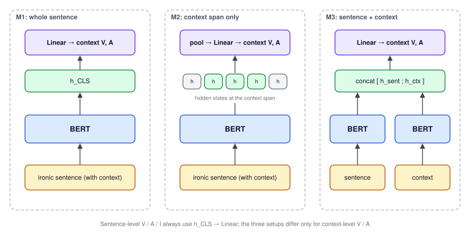

## Paper Info

| Item | Details |
|---|---|
| Venue | ROCLING 2022 (34th Conference on Computational Linguistics and Speech Processing) |
| Authors | Sheng-Wei Huang, **Wei-Yi Chung**, Yu-Hsuan Wu, Chen-Chia Yu, Jheng-Long Wu |
| Links | [ACL Anthology](https://aclanthology.org/2022.rocling-1.19/) · [PDF](https://aclanthology.org/2022.rocling-1.19.pdf) |
| Code | No public repo |
| Journal extension | [A Chinese Dimensional Valence-Arousal-Irony Detection on Sentence-level and Context-level]() (IJCLCLP 2022) |

In January 2022 I wrote the first draft of this work as first author (then called VAI); co-authors carried it forward into the ROCLING and journal versions. Annotation used the Irony Extension labeling website I built in 2021.

This paper is about **the dataset itself**: how irony is defined, how scores are given, how consistent the annotators are, and a BERT baseline showing the data can be learned. The journal version runs a fuller set of model experiments.

## Motivation

The defining feature of irony is that **the literal meaning is the opposite of the intended one**. The most common pattern in Chinese wraps a negative event in a positive keyword:

> "Great, it's raining and I didn't bring an umbrella..."

The context "raining without an umbrella" is negative, the keyword "Great" is positive, and the gap between them is what makes it ironic. So understanding irony **requires looking at the context**.

Earlier datasets mostly could not support that:

| Dataset | What it labels | What is missing |
|---|---|---|
| Ciron (Xiang et al., 2020) | Irony intensity of 8.7K Weibo posts | No context, no other sentiment dimensions |
| NTU Irony Corpus (Tang & Chen, 2014) | Positions of ironic sentences and their context | No sentiment scores at all |
| VAI corpus of Xie et al. (2021) | Sentence valence, arousal, and irony | Context not considered |
| English corpora (Senti-TUT, SemEval-2015 Task 11, …) | Irony or VA, rarely all three | English cues such as all-caps words do not exist in Chinese |

Studies also show the three indicators are correlated: stronger irony tends to come with lower valence (more negative) and higher arousal. The paper therefore argues for annotating **V, A, and I together**, and for scoring **the sentence and its context separately**, so a model can learn the sentiment shift inside irony.

## Dataset: CDVAI

CDVAI (Chinese Dimensional Valence-Arousal-Irony) extends the NTU Irony Corpus, the only Chinese corpus that marks both ironic sentences and their context, by adding sentiment scores on top.

After filtering, **1,004 sentences** remain, **843** of which have an ironic context to annotate.

- **Sentence level**: valence, arousal, and irony intensity.
- **Context level**: valence and arousal intensity (the context has no ironic keyword, so it gets no irony score).

### Defining irony

Following Li & Huang (2020), irony is "an expression in which the true meaning is the opposite of the literal meaning". In the NTU corpus the **context** is usually a negative description and carries the true meaning, while the **ironic keyword** is usually positive and flips the literal meaning.

### Annotation guidelines (1–5)

**Valence**

- 1–2: negative
- 3: neutral, or cannot tell
- 4–5: positive

**Arousal**

| Score | Criterion |
|---|---|
| 0 | A purely objective statement, such as "I am a student" |
| 1 | Close to objective, or hard to tell whether there is emotion |
| 2 | Emotion can be felt, but there is no emotion word |
| 3 | Explicit emotion words such as sad, annoyed, lost, happy |
| 4 | Clearly strong emotion such as madness, rage, excitement; may contain aggressive language |
| 5 | Extreme wording, discrimination, hatred, or obvious manic emotion |

**Irony**

Irony intensity depends on the gap between **how positive the ironic keyword is** and **how negative the context is**. The paper ranks the ironic keywords in the corpus as wonderful > great > very good > good.

| Score | Criterion |
|---|---|
| 1 | Very small gap, or the context is close to objective, e.g. "Good, it's raining" |
| 2 | Moderate gap |
| 3 | Clear gap |
| 4 | Big gap |
| 5 | Very large gap; may contain discriminatory or morally unacceptable metaphors |

### Annotation quality

Each sentence was scored independently by three annotators (graduate students and an undergraduate, all native Chinese speakers aged 20–25), and **the average of the three is the gold label**.

The paper does not use Cohen's kappa, because the labels are continuous intensities: the guidelines set score baselines rather than asking everyone to pick the same class. It measures agreement as the **MAE between annotators** instead:

| Level | Indicator | MAE between the three annotators |
|---|---|---|
| Sentence | Valence | 0.05–0.31 |
| Sentence | Arousal | 0.25–0.41 |
| Sentence | Irony | 0.22–0.56 |
| Context | Valence | 0.07–0.40 |
| Context | Arousal | 0.15–0.65 |

All differences stay within one point, so the guidelines work. Irony and context arousal disagree the most, which makes sense since irony intensity is the most subjective.

### An annotation example

The paper walks through a post complaining about a factory colleague. It opens with "Very good (applause)", complains that the colleague has worked there for years but cannot send a meeting invite in Outlook, then swears and adds "give me your salary and I'll send it for you".

- **Valence 1**: the swearing and complaints are highly negative.
- **Arousal 5**: clear abusive and manic language.
- **Irony 4**: "very good" is only weakly positive, but the incident upset the writer a lot, so the gap is large; "give me your salary and I'll send it for you" is a second ironic span, which pushes the score up.
- **Context**: the context carries the same sentiment as the whole sentence, so it also gets V 1 and A 5.

### Score distribution

Averaged scores, rounded:

| Level | Indicator | 0 | 1 | 2 | 3 | 4 | 5 |
|---|---|---|---|---|---|---|---|
| Sentence | Valence | 0 | 380 | 624 | 0 | 0 | 0 |
| Sentence | Arousal | 0 | 60 | 406 | 369 | 150 | 46 |
| Sentence | Irony | 0 | 181 | 428 | 310 | 75 | 20 |
| Context | Valence | 0 | 302 | 516 | 25 | 0 | 0 |
| Context | Arousal | 56 | 279 | 264 | 161 | 76 | 26 |

- Every sentence is ironic, so sentence valence is always negative (1–2).
- Sentence arousal sits mostly at 2–4, since most sentences carry emotion.
- **Context arousal is clearly lower than sentence arousal**: removing the ironic keyword also removes the exaggerated tone, which shows the keyword itself raises arousal.
- Irony is spread more evenly, but high scores are rare because they mean a large factual gap.

## Model Architecture

To check that the annotations are learnable, the paper uses BERT as an encoder to predict sentence-level VAI and context-level VA.

**Sentence level**: the sentence goes through BERT and a linear layer outputs valence, arousal, and irony.

**Context level**: the context span is already marked in each sentence, so three setups are compared:

| Setup | How | Question it tests |
|---|---|---|
| M1 | Whole sentence through BERT, then a linear layer predicts the context VA | Is the whole sentence enough? |
| M2 | Whole sentence through BERT; only the hidden states at the context span are averaged, then a linear layer | Does focusing on the span help? |
| M3 | Sentence and context go through BERT separately; the two hidden vectors are concatenated, then a linear layer | Does seeing both help? |

## Experimental Setup

**Splits**: stratified sampling into train and test (7:3), with one tenth of train held out for validation.

| Level | Train | Validation | Test |
|---|---|---|---|
| Sentence | 632 | 71 | 301 |
| Context | 531 | 59 | 253 |

**Hyperparameters**: Adam, 50 epochs. Sentence-level learning rates 4e-4, 4e-5, 4e-6; the context carries less information, so it tries smaller rates of 4e-5, 4e-6, 4e-7.

**Six pre-trained models**:

| ID | Model | Pre-training corpus |
|---|---|---|
| PM1 | ckiplab/albert-base-chinese | Chinese Wikipedia |
| PM2 | hfl/chinese-macbert-base | Simplified and traditional Chinese Wikipedia |
| PM3 | shibing624/macbert4csc-base-chinese | SIGHAN spelling-correction corpus |
| PM4 | uer/chinese_roberta_L-4_H-256 | UER-py pre-training |
| PM5 | bert-base-multilingual-uncased | Multilingual Wikipedia |
| PM6 | flax-community/alberti-bert-base-multilingual-cased | Multilingual poetry corpus |

## Results

### Sentence level (MAE, lower is better)

| Model | Valence | Arousal | Irony |
|---|---|---|---|
| PM1 | **0.319** | 0.532 | 0.548 |
| PM2 | 0.347 | **0.522** | 0.522 |
| PM3 | 0.339 | 0.526 | 0.532 |
| PM4 | 0.334 | 0.532 | 0.533 |
| PM5 | 0.353 | 0.536 | **0.520** |
| PM6 | 0.332 | 0.529 | 0.526 |

- **Valence is the easiest**: every model is below 0.4.
- **Arousal and irony both stay above 0.5.** The paper's explanation: arousal is judged from how serious the described event is, not just word intensity; and irony can come from several spans in one sentence, not a single keyword. Neither is easy to learn from surface wording.

### Context level (MAE)

| Model | V-M1 | V-M2 | V-M3 | A-M1 | A-M2 | A-M3 |
|---|---|---|---|---|---|---|
| PM1 | 0.438 | 0.452 | 0.456 | 0.813 | 0.835 | **0.787** |
| PM2 | 0.431 | 0.451 | 0.422 | 0.819 | 0.817 | **0.793** |
| PM3 | **0.401** | 0.451 | 0.422 | **0.743** | 0.817 | 0.793 |
| PM4 | **0.417** | 0.463 | 0.438 | **0.767** | 0.857 | 0.788 |
| PM5 | 0.425 | 0.438 | **0.388** | 0.829 | 0.824 | **0.799** |
| PM6 | **0.429** | 0.433 | 0.432 | 0.847 | 0.840 | **0.806** |

- **Context valence**: around 0.45 whatever the setup. M1 is still best for most models and M2 never beats it; the paper suspects that focusing on the span or concatenating adds noise. The best result is PM5 with M3 (0.388).
- **Context arousal**: much harder, around 0.8. Here **M3 wins for most models**, so seeing the sentence and the context together helps judge arousal; M2 barely helps.

### Error analysis

> "Very good... even the speakers are broken X-(", with the context "even the speakers are broken"

| | Sentence V | Sentence A | Sentence I | Context V | Context A |
|---|---|---|---|---|---|
| Gold | 2 | 3 | 1 | 2 | 3 |
| Predicted | 1.71 | 3.45 | 1.94 | 1.63 | 1.97 |

- The model rates valence too negative, perhaps treating "even" and "broken" as strongly negative words. A broken speaker is usually not that upsetting, which takes **common sense** the model lacks.
- Irony is over-predicted: the model sees a large gap between "very good" and the negative valence, but the sentence has no other ironic span, so the gold score is low.

Overall, BERT's main difficulties are **inferring the speaker's intent** and **judging how serious the event is**.

## Conclusion and Limitations

- CDVAI is the first Chinese dataset to annotate sentiment intensity for **ironic context**, which lets a model learn the sentiment contrast between a sentence and its context.
- The baseline shows the data is learnable, and M3 (sentence plus context) helps context arousal.
- The dataset is still small for machine learning and cannot cover every domain or ironic pattern. It works best as seed data for collecting more samples, as an annotation-guideline template, or combined with other irony corpora.

The journal version applies M1/M2/M3 at the sentence level too, switches to a different set of Chinese pre-trained models, and adds automatic context-span prediction; see [the journal post]().
