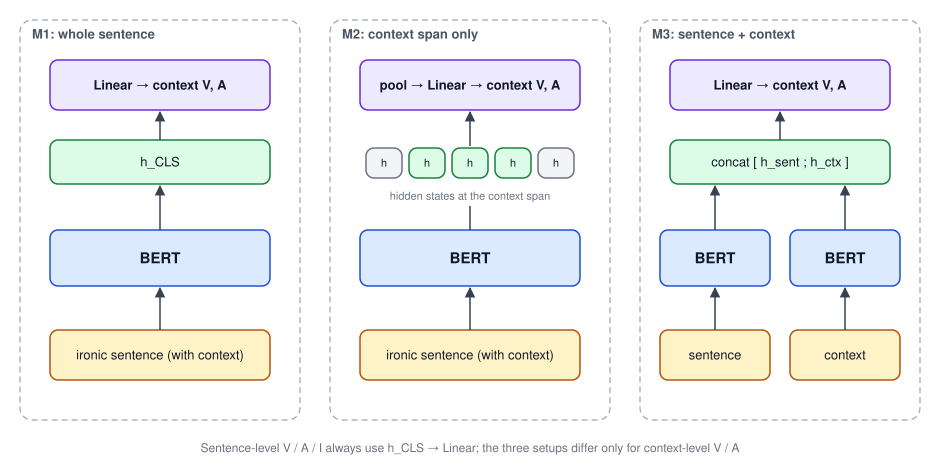

## 論文資訊

| 項目 | 內容 |
|---|---|
| 發表 | ROCLING 2022（第 34 屆自然語言與語音處理研討會） |
| 作者 | Sheng-Wei Huang, **Wei-Yi Chung**, Yu-Hsuan Wu, Chen-Chia Yu, Jheng-Long Wu |
| 連結 | [ACL Anthology](https://aclanthology.org/2022.rocling-1.19/) · [PDF](https://aclanthology.org/2022.rocling-1.19.pdf) |
| 程式碼 | 沒有公開 repo |
| 期刊延伸版 | [A Chinese Dimensional Valence-Arousal-Irony Detection on Sentence-level and Context-level]()（IJCLCLP 2022） |

2022 年 1 月我以第一作者寫了這個題目的初稿（當時叫 VAI），之後的 ROCLING 版本與期刊版本由共同作者接續修改。標註用的是我在 2021 年做的 Irony Extension 標記網站。

這篇的重點是**資料集本身**：怎麼定義反諷、怎麼給分、標註品質如何，最後用 BERT 跑一組基準實驗，確認資料可以拿來訓練模型。期刊版則把模型實驗做得更完整。

## 研究動機

反諷的核心特徵是**字面意思和實際意思相反**。中文反諷最常見的寫法，是用正面的關鍵字包裝負面的事件，例如：

> 「好棒喔，下雨了又沒帶傘……」

語境「下雨了又沒帶傘」是負面的，關鍵字「好棒喔」是正面的，兩者的情緒落差就構成了反諷。所以要理解一句反諷，**一定要把語境一起看**。

但過去的資料集大多做不到這件事：

| 資料集 | 標了什麼 | 缺什麼 |
|---|---|---|
| Ciron（Xiang et al., 2020） | 8.7K 則微博貼文的反諷程度 | 沒有語境，也沒有其他情緒維度 |
| NTU Irony Corpus（Tang & Chen, 2014） | 反諷句與反諷語境的位置 | 沒有任何情緒分數 |
| Xie et al.（2021）的 VAI 語料 | 句子的 Valence、Arousal、Irony | 沒有考慮語境 |
| 英文語料（Senti-TUT、SemEval-2015 Task 11 等） | 反諷或 VA 其中一部分 | 很少三者一起標；英文的線索（例如全大寫）也不適用中文 |

另一方面，研究也發現三個指標彼此相關：反諷越強，Valence 往往越低（越負面）、Arousal 越高。所以這篇主張要**同時標註 V、A、I**，而且**句子和語境要分開標**，模型才有機會學到反諷裡的情緒轉折。

## 資料集：CDVAI

CDVAI（Chinese Dimensional Valence-Arousal-Irony）以 NTU Irony Corpus 為基礎擴充。NTU 語料是唯一同時提供反諷句和反諷語境的中文資料，所以可以直接在上面加情緒分數。

篩選後保留 **1,004 句**，其中 **843 句**有需要標註的反諷語境。

- **句子層級**：標註 Valence、Arousal、Irony 三種強度。
- **語境層級**：標註 Valence、Arousal 兩種強度（語境本身不帶反諷關鍵字，所以不標 Irony）。

### 反諷的定義

論文採用 Li & Huang（2020）的說法：「反諷是一種實際意思和字面意思相反的表達」。在 NTU 語料裡，**語境**通常是負面描述，代表句子的真正意思；**反諷關鍵字**通常是正面描述，讓字面意思和語境相反。

### 標註規範（1～5 分）

**Valence（正負向）**

- 1～2 分：負面情緒
- 3 分：中性，或無法判斷
- 4～5 分：正面情緒

**Arousal（激動程度）**

| 分數 | 判斷標準 |
|---|---|
| 0 | 完全客觀的描述，例如「我是學生」 |
| 1 | 接近客觀描述，或很難判斷有沒有情緒 |
| 2 | 感覺得到情緒，但句子裡沒有情緒詞 |
| 3 | 有明確的情緒詞，例如難過、煩、失落、開心 |
| 4 | 能明顯感受到強烈情緒，例如抓狂、暴怒、興奮；可能含有攻擊性用語 |
| 5 | 用詞極端，帶有歧視、仇恨或明顯的躁怒 |

**Irony（反諷程度）**

反諷程度取決於**反諷關鍵字的正面程度**和**語境的負面程度**之間的落差。論文把語料中的反諷關鍵字依正面程度排成 wonderful > great > very good > good（論文以英文翻譯列出）。

| 分數 | 判斷標準 |
|---|---|
| 1 | 關鍵字和語境的落差很小，或語境接近客觀描述，例如「好，下雨了」 |
| 2 | 落差中等 |
| 3 | 落差明顯 |
| 4 | 落差很大 |
| 5 | 落差極大，句子可能含有歧視或違反道德的隱喻 |

### 標註品質

每句由三位標註者獨立評分（研究生與大學生，都是 20～25 歲的中文母語者），**取三人平均作為標準答案**。

論文沒有用 Cohen's kappa 這類分類一致性指標，因為這裡的分數是連續的強度，標註規範的目的是「定出分數的基準線」，不是要求每個人給出一樣的類別。所以改用**標註者之間的 MAE** 衡量一致性：

| 層級 | 指標 | 三位標註者之間的 MAE |
|---|---|---|
| 句子 | Valence | 0.05～0.31 |
| 句子 | Arousal | 0.25～0.41 |
| 句子 | Irony | 0.22～0.56 |
| 語境 | Valence | 0.07～0.40 |
| 語境 | Arousal | 0.15～0.65 |

差距都在 1 分以內，代表標註規範有效。Irony 和語境 Arousal 的分歧最大，這也合理：反諷程度本來就最主觀。

### 一個標註例子

論文舉了一則抱怨工廠同事的貼文：開頭是「很好（鼓掌）」，接著抱怨同事上班很多年卻不會用 Outlook 發會議通知，最後還罵了髒話，說「薪水給我，我就幫你發」。

- **Valence 1 分**：髒話和抱怨都非常負面。
- **Arousal 5 分**：有明顯的辱罵和躁怒。
- **Irony 4 分**：「很好」本身只是微弱的正面詞，但事件讓發文者非常不舒服，落差很大；而且「薪水給我就幫你發」本身也是另一段反諷，所以給高分。
- **語境**：語境的情緒和整句一致，所以 V 和 A 也是 1 分和 5 分。

### 分數分布

以下是三人平均後四捨五入的分數分布：

| 層級 | 指標 | 0 | 1 | 2 | 3 | 4 | 5 |
|---|---|---|---|---|---|---|---|
| 句子 | Valence | 0 | 380 | 624 | 0 | 0 | 0 |
| 句子 | Arousal | 0 | 60 | 406 | 369 | 150 | 46 |
| 句子 | Irony | 0 | 181 | 428 | 310 | 75 | 20 |
| 語境 | Valence | 0 | 302 | 516 | 25 | 0 | 0 |
| 語境 | Arousal | 56 | 279 | 264 | 161 | 76 | 26 |

- 資料都是反諷句，所以句子的 Valence 全部落在負面（1～2 分）。
- 句子 Arousal 集中在 2～4 分，因為大部分句子都帶情緒。
- **語境的 Arousal 明顯比句子低**：拿掉反諷關鍵字之後，誇張的語氣也跟著不見了。這正好說明反諷關鍵字會拉高激動程度。
- Irony 分布比較平均，但高分很少，因為高分代表事實落差很大。

## 模型架構

為了驗證標註的可用性，論文用 BERT 當編碼器，預測句子的 VAI 和語境的 VA。

**句子層級**：句子進 BERT，取隱藏向量接一層 Linear，輸出 Valence、Arousal、Irony 三個分數。

**語境層級**：資料已經標好語境在句子中的位置，因此比較三種預測語境 VA 的方式：

| 方法 | 做法 | 想驗證什麼 |
|---|---|---|
| M1 | 整句進 BERT，直接接 Linear 預測語境的 VA | 整句的資訊夠不夠 |
| M2 | 整句進 BERT，只取語境那一段位置的隱藏向量，平均後接 Linear | 只看語境位置會不會更準 |
| M3 | 句子和語境分別進 BERT，把兩個隱藏向量串接後接 Linear | 同時給整句和語境會不會更好 |

## 實驗設定

**資料切分**：以分層抽樣切出訓練和測試集（7:3），再從訓練集切 1/10 當驗證集。

| 層級 | 訓練 | 驗證 | 測試 |
|---|---|---|---|
| 句子 | 632 | 71 | 301 |
| 語境 | 531 | 59 | 253 |

**超參數**：Adam，訓練 50 個 epoch。句子層級的學習率試 4e-4、4e-5、4e-6；語境的資訊比整句少，所以試更小的 4e-5、4e-6、4e-7。

**比較的六個預訓練模型**：

| 代號 | 模型 | 預訓練語料 |
|---|---|---|
| PM1 | ckiplab/albert-base-chinese | 中文維基 |
| PM2 | hfl/chinese-macbert-base | 簡體與繁體中文維基 |
| PM3 | shibing624/macbert4csc-base-chinese | SIGHAN 錯字更正語料 |
| PM4 | uer/chinese_roberta_L-4_H-256 | UER-py 預訓練 |
| PM5 | bert-base-multilingual-uncased | 多語維基 |
| PM6 | flax-community/alberti-bert-base-multilingual-cased | 多語詩歌語料 |

## 實驗結果

### 句子層級（MAE，越低越好）

| 模型 | Valence | Arousal | Irony |
|---|---|---|---|
| PM1 | **0.319** | 0.532 | 0.548 |
| PM2 | 0.347 | **0.522** | 0.522 |
| PM3 | 0.339 | 0.526 | 0.532 |
| PM4 | 0.334 | 0.532 | 0.533 |
| PM5 | 0.353 | 0.536 | **0.520** |
| PM6 | 0.332 | 0.529 | 0.526 |

- **Valence 最好學**：所有模型的 MAE 都低於 0.4。
- **Arousal 和 Irony 都超過 0.5**。論文的解釋是：Arousal 不只看用詞的強度，而是看整件事的嚴重程度；Irony 也不只來自單一個反諷關鍵字，一句話裡可能有好幾段反諷。這些都很難只從字面學到。

### 語境層級（MAE）

| 模型 | V-M1 | V-M2 | V-M3 | A-M1 | A-M2 | A-M3 |
|---|---|---|---|---|---|---|
| PM1 | 0.438 | 0.452 | 0.456 | 0.813 | 0.835 | **0.787** |
| PM2 | 0.431 | 0.451 | 0.422 | 0.819 | 0.817 | **0.793** |
| PM3 | **0.401** | 0.451 | 0.422 | **0.743** | 0.817 | 0.793 |
| PM4 | **0.417** | 0.463 | 0.438 | **0.767** | 0.857 | 0.788 |
| PM5 | 0.425 | 0.438 | **0.388** | 0.829 | 0.824 | **0.799** |
| PM6 | **0.429** | 0.433 | 0.432 | 0.847 | 0.840 | **0.806** |

- **語境 Valence**：不管哪種方法，MAE 都在 0.45 左右。多數模型還是 M1 最好，M2 並沒有比 M1 好，論文推測只取語境位置或額外串接，反而帶進更多雜訊。最佳是 PM5 搭配 M3（0.388）。
- **語境 Arousal**：整體比 Valence 難很多，MAE 約 0.8。這裡 **M3 在多數模型上最好**，代表同時看整句和語境，對判斷激動程度有幫助；M2 則幫助不大。

### 錯誤分析

> 「很好……連喇叭都壞了 X-(」，語境是「連喇叭都壞了」

| | 句子 V | 句子 A | 句子 I | 語境 V | 語境 A |
|---|---|---|---|---|---|
| 標註 | 2 | 3 | 1 | 2 | 3 |
| 預測 | 1.71 | 3.45 | 1.94 | 1.63 | 1.97 |

- 模型把 Valence 判得太負面，可能是「連」、「壞了」被當成強烈的負面詞。但喇叭壞掉通常不會讓人那麼生氣，模型缺乏這種**常識**。
- Irony 預測偏高：模型看到「很好」（正面）和偏負面的 Valence 落差很大，就給了高分；但這句沒有其他加強反諷的片段，所以標註分數其實很低。

整體來看，BERT 的主要困難是**推斷說話者的意圖**，以及**判斷事件到底有多嚴重**。

## 結論與限制

- CDVAI 是第一個替**反諷語境**標註情緒強度的中文資料集，讓模型有機會學到句子和語境之間的情緒反差。
- 基準實驗顯示資料可以學，而 M3（串接句子和語境）對語境 Arousal 有幫助。
- 限制是資料量對機器學習還不夠大，也無法涵蓋所有領域與反諷句型。比較適合當作擴充樣本的種子資料、標註規範的範本，或和其他反諷語料合併使用。

後續的期刊版把 M1/M2/M3 也用在句子層級、換了一組中文預訓練模型，並加上自動預測語境位置的實驗，整理在[期刊版那篇]()。
