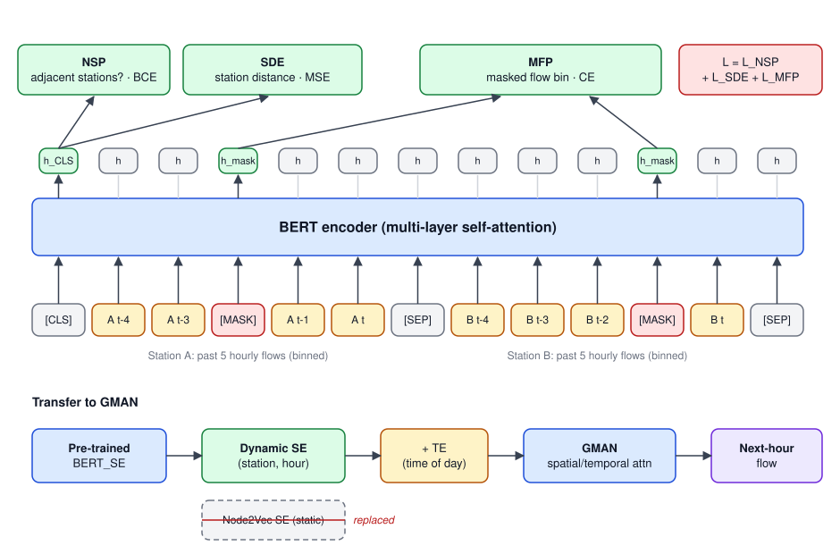
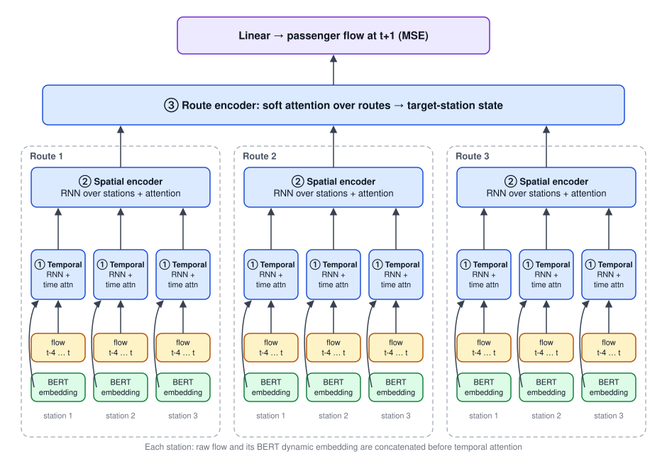
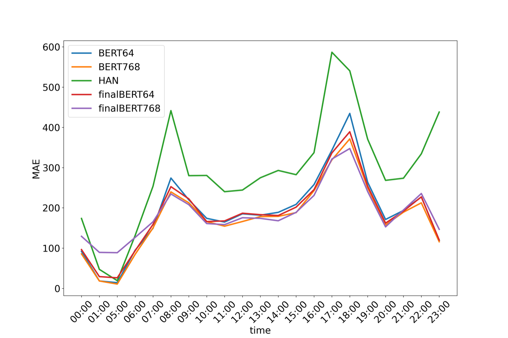
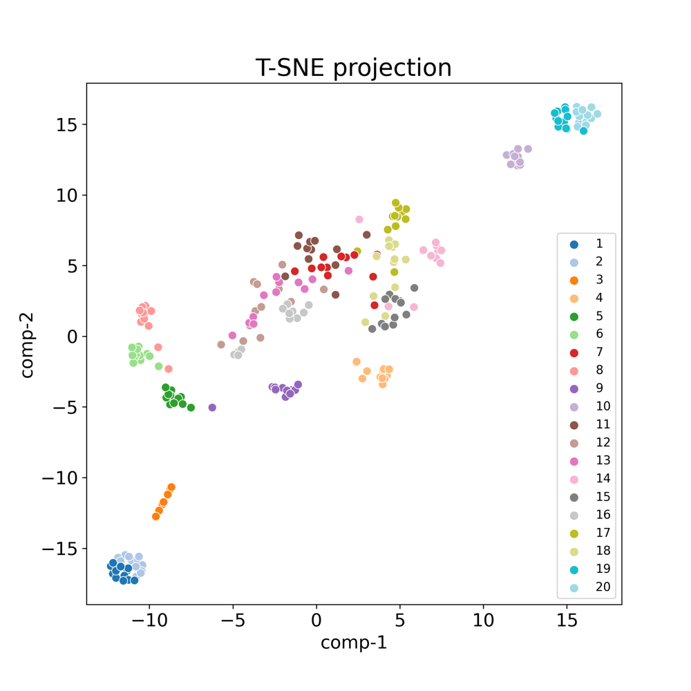

## Paper Info

| Item | Details |
|---|---|
| Venue | Knowledge-Based Systems, Vol. 304, 112442 (2024) |
| Title | Dynamic traffic network representation model for improving the prediction performance of passenger flow for mass rapid transit |
| Authors | Jheng-Long Wu, **Wei-Yi Chung**, Yu-Hsuan Wu, Yen-Nan Ho |
| DOI | [10.1016/j.knosys.2024.112442](https://doi.org/10.1016/j.knosys.2024.112442) |
| Code | No separate repo; pre-training reuses the [IIAI-AAI 2021 repo](https://github.com/h30306/A-Dynamic-Embedding-Method-for-Passenger-Flow-Estimation) |

This is the journal extension of [A Dynamic Embedding Method for Passenger Flow Estimation](). Between June 2021 and January 2022 I wrote the journal manuscript (Chinese and English) and ran the experiments; the paper was published in 2024.

> This post is based on my January 2022 submission draft. The manuscript went through several revision rounds during review, so model details and numbers in the published version may differ; please cite the journal version.

**In one sentence**: the conference paper showed dynamic station embeddings beat static ones; the journal version pushes further. Pre-training grows from two objectives to four so BERT learns more spatial concepts, and the downstream model changes from GMAN to a three-level Hierarchical Attention Network (HAN) over time, stations and routes. Adding the BERT representation cuts average MAE over 20 stations from 290.58 to 175.84, with the largest gains at peak hours.

## Differences from the Conference Version

| Aspect | Conference (IIAI-AAI 2021) | Journal (KBS 2024 draft) |
|---|---|---|
| Pre-training objectives | SDE + MFP (code adds an adjacency head) | MFP + SRP + ASP + SDE, four in total |
| Downstream model | GMAN, replacing only its Spatial Embedding | A custom three-level HAN (time → station → route) |
| Station selection | 10 transfer + 10 non-transfer | Still 20, chosen by KL divergence for diverse flow distributions |
| Spatial scope | Filter neighbours by distance (1500 / 2000 m) | Number of adjacent stations along each route (1–4) |
| Embedding size | 64 | 64 and 768 compared |
| Metrics | MAE, RMSE | MAE, MSE, MdAE |

## Motivation

### Peak vs off-peak

Earlier traffic research mostly predicted flow from **static station features**, but peak and off-peak flows differ enormously, so the same features produce biased predictions across situations. The conference paper showed dynamic embeddings help; the journal version asks whether dynamic features give more stable predictions at **stations and times with large flow changes**.

### Flow arrives from different directions

A common approach concatenates every feature and feeds them into a time-series model such as LSTM. That uses all the raw data, but if features differ greatly in importance the model may not learn it.

An MRT station receives flow from at least two directions, and a transfer station from four or five; each route affects the target station differently at peak and off-peak. Estimating **the importance of each flow source** should make predictions more accurate. That is why a hierarchical attention model was chosen: it weighs features at three levels and down-weights routes with little influence on the target station.

### Why pre-train with BERT

Pre-training learns from lots of in-domain data first and then transfers to the target task, which helps most when data are limited. Earlier traffic pre-training mostly used time-series or simple architectures (DBN, SAE, ANN). BERT differs in that its output is **generated dynamically from the current input**. Word2Vec and graph embeddings are essentially lookups, so a station always gets the same vector; BERT produces features that match the flow at this point in time.

## Related Work

The manuscript reviews three areas:

- **Traffic flow prediction**: from classic machine learning (SVR, ARIMA), to stacked auto-encoders (SAE) for deeper features, to graph models with spatio-temporal features (e.g. STGCN, dynamic graph neural networks).
- **Deep learning in transport**: MRT data mostly come from gate entry/exit records, which are complete and simple. Work includes clustering (on station surroundings, or on seasons, holidays and weekdays), plus many LSTM, LSTM + CNN and graph-model applications. Highway data come from vehicle sensors and GPS and support more varied targets (per-vehicle-type flow, travel delay, congestion detection).
- **Pre-trained traffic models**: DBNs learning flow features unsupervised and then fine-tuned, ANNs pre-trained on traffic state, and SAEs pre-trained on real-time flow feeding a DNN for bus-stop prediction. Fairly simple models already gave solid gains, showing pre-training works for traffic prediction.

## Model Architecture

There are still two stages: pre-train a BERT flow embedding, then feed it to a three-level HAN that predicts the next time step's flow.

### Stage 1: pre-training with four objectives

The input format matches the conference version: two stations, each with its last 5 binned flow values, joined as `[CLS] … [SEP] … [SEP]` with random masking. `[SEP]` tells the model the two sequences come from different sources, so it learns what each sequence represents.



(The figure shows the three heads from the conference code; the journal version uses the four objectives below.)

MFP is the main objective, with three auxiliary objectives so the model learns more **spatial concepts** beyond numeric change:

| Objective | Output used | Predicts | Why | Loss |
|---|---|---|---|---|
| MFP (Mask Flow Prediction, main) | `h` at masked positions | The masked flow bin | Learn flow change over time, including peak vs off-peak | Cross-entropy |
| SRP (Same Route Prediction) | `h_CLS` + sigmoid | Whether both sequences are on the same route | Give the model a sense of routes and how inputs relate | Cross-entropy |
| ASP (Adjacent Station Prediction) | `h_CLS` + sigmoid | Whether the two stations are adjacent | Learn flow differences and coupling between neighbours | Cross-entropy |
| SDE (Station Distance Estimation) | `h_CLS` | Straight-line distance between the stations | Flow characteristics vary with space; separate city-centre and suburban stations | MSE |

Since BERT has already passed features through many self-attention layers, SRP, ASP and SDE only need the first position, `h_CLS`. The four losses are summed and optimised with Adam:

```text
L(θ_BERT) = l_MFP + l_SRP + l_ASP + l_SDE
```

After pre-training, only the **hidden layer** is transferred as the flow feature for the downstream model.

### Stage 2: Hierarchical Attention Network (HAN)



The design borrows from the Hierarchical Attention Network for document classification (word → sentence → document) and swaps in **time step → station → route**. The input is a tensor `X ∈ R^{R×S×T}`: number of routes, stations per route and time steps.

**1. Temporal Feature Encoder**

For each station, the raw flow sequence goes through an RNN, and the same flow goes through BERT to get its dynamic embedding. The two are **concatenated**, and soft attention decides how much each past time step matters:

```text
h_t = concat[RNN(x_t), BERT(x_t)]
u_t = tanh(W_t · h_t + b_t)
α_t = softmax(u_t)
s   = Σ_t α_t · h_t          # this station's temporal state
```

BERT's output is already an estimated hidden state, so the raw data first go through an RNN to bring both sides to the same level of representation.

**2. Spatial Feature Encoder**

Along each route, the temporal states of the `st` stations nearest the target are fed into an RNN in line order (stations along a route are sequential), then weighted with soft attention to get that route's influence on the target. The output is one vector per route, R in total.

**3. Route Feature Encoder**

A station's flow can come from several routes, each from different areas (city centre, suburbs, residential) carrying different information. Routes have **no inherent order**, so this layer uses soft attention only, without an RNN, to weight each route and produce the target station's final hidden state.

**4. Prediction layer**

After three levels of attention the hidden vector covers time, station and route, so a single Linear layer outputs the next time step's flow. Training uses MSE with Adam.

## Experimental Setup

### Splits and hyperparameters

Split by time: 2017/01–2018/09 for training, 2018/10–2018/12 for validation (model selection), 2019/01–2019/03 for testing.

| Parameter | Value | Meaning |
|---|---|---|
| hp | 5 | Length of flow history |
| st | 1, 2, 3, 4 | Adjacent stations taken per route |
| lr | 1e-3 | Learning rate |
| es | 64, 768 | BERT embedding size, also HAN's hidden size |

### Station selection with KL divergence

Taipei MRT has many stations, and the experiments use 20. Stations with similar flow distributions likely share characteristics, so selection uses **KL divergence** between stations' flow distributions and deliberately picks stations that differ a lot. Even the non-transfer stations then vary widely, which tests whether the model stays robust under extreme variation.

| | Max flow | Mean flow |
|---|---|---|
| Non-transfer | 7,858 | 1,829 |
| Transfer | 16,530 | 4,342 |

Transfer stations have roughly twice the maximum and mean of non-transfer stations, and much higher variance. Their flow changes a lot over time, which makes them harder to predict but also more important: accurate transfer-station predictions help MRT scheduling the most.

Per station, maximum hourly flow ranges from 1,359 to 24,553 across the 10 non-transfer stations and from 7,174 to 46,225 across the 10 transfer stations; the busiest transfer station averages about 15,018 passengers per hour with a standard deviation of about 8,949.

### Models compared

| Model | Description |
|---|---|
| HAN | Plain HAN; the temporal layer uses only the RNN output, no BERT embedding |
| BERT768 | Main model: 768-d BERT embedding concatenated in the temporal layer |
| BERT64 | BERT hidden size and RNN output reduced to 64, to measure the effect of embedding size and cut training time |
| finalBERT768 | BERT embedding fed to HAN's last layer (before prediction) instead of the temporal layer; the temporal layer uses only the RNN |
| finalBERT64 | Same as above with a 64-d embedding |

The idea behind finalBERT: BERT's output is already an information-rich vector after many attention layers, so maybe it doesn't need to pass through HAN again and can go straight to the end.

## Results

### 1. Overall (average over 20 stations)

| Model | MAE | MSE | MdAE |
|---|---|---|---|
| HAN | 290.58 | 443,642.63 | 230.08 |
| finalBERT64 | 187.36 | 142,881.13 | 138.38 |
| finalBERT768 | 185.54 | 128,920.94 | 142.22 |
| BERT64 | 189.38 | 164,135.76 | 140.52 |
| BERT768 | **175.84** | **128,396.65** | **129.58** |

BERT768 is best on all three metrics.

- **BERT helps a lot**: every BERT variant far outperforms plain HAN. MAE drops from 290.58 to 175.84, and MSE falls to under a third.
- **768-d beats 64-d**: wherever the embedding goes, the 768-d versions reach an MSE of about 128k, better than the 64-d ones; a larger embedding carries richer information.
- **The temporal layer beats the last layer**: finalBERT models sit around 185–187 MAE, still behind BERT768's 175.84. Passing BERT's vector through HAN's attention levels improves it further.

### 2. By time of day



The x-axis is the hour (the MRT does not run 02:00–04:00, so there is no data) and the y-axis is MAE:

- **HAN is the worst in almost every hour**, especially in the 07:00–09:00 and 16:00–19:00 peaks; at 17:00 its error approaches 600.
- The BERT models cut peak-hour error substantially, showing that **dynamic embeddings help most when flow changes a lot**.
- At 23:00, when flow drops quickly, HAN also struggles while the BERT models are clearly better.
- In the early morning, with low and stable flow, the two families are close. The plot shows finalBERT768 actually doing worse between 01:00 and 05:00.
- In both peaks, BERT64 is the weakest of the four BERT models, followed by finalBERT64. High-variance periods need higher-dimensional vectors.

### 3. Transfer vs non-transfer stations

Counting, per station, whether HAN or the BERT family wins:

| Winner | Transfer (10 stations) | Non-transfer (10 stations) |
|---|---|---|
| HAN | 1 | 6 |
| BERT family | 9 | 4 |

The BERT family wins at 9 of 10 transfer stations, while HAN is slightly better at non-transfer stations. This matches the conference finding: dynamic embeddings clearly help at **high-variance transfer stations** and are only slightly behind at non-transfer ones.

### 4. Visualising the dynamic vectors



BERT's dynamic vectors are projected to 2-D with t-SNE. Each station's 2017 data are averaged by month, giving 12 points per station; colours are station IDs (1–10 non-transfer, 11–20 transfer):

- Points spread from lower left to upper right, and **busier stations sit further up and right**; non-transfer stations 1–10 are mostly in the lower left.
- Station 10 is non-transfer but busier than many stations, so it also lands in the upper right.
- Stations 19 and 20 are the two busiest in the Taipei MRT; they are both transfer stations and adjacent to each other, so their clusters almost overlap.
- Stations 1 and 2 are also close, for the opposite reason: both are end-of-line stations with very low flow.

In other words, the learned vectors reflect stations' flow volume and spatial relationships rather than arbitrary codes.

## Conclusion and My Observations

**Conclusion**: BERT is pre-trained with several self-supervised objectives to learn flow characteristics, then connected to a HAN that attends to MRT data from time, station and route perspectives to predict future flow. The pre-trained features improve HAN, especially for highly variable flow, and the model generalises and stays robust across flow situations. Future work is to pre-train BERT with more objectives to deepen its understanding of passenger flow.

**Looking back**:

- Judging by their magnitude, the errors are in raw passenger counts (MAE ≈ 175), so they can't be compared directly with the conference paper's log-normalised errors; the downstream model and station selection also differ.
- HAN still edges out at non-transfer stations; the value of dynamic embeddings is concentrated in high-variance situations.
- 768-d beats 64-d but costs more to train, so in practice it is a trade-off between accuracy and cost.

## Code and Resources

- Code for pre-training the BERT dynamic representation is in the [IIAI-AAI 2021 repo](https://github.com/h30306/A-Dynamic-Embedding-Method-for-Passenger-Flow-Estimation).
- The downstream HAN code is not on GitHub.
- My local folder keeps every journal draft (`交通期刊_Howard_202106xx` to `交通期刊_英文_Howard_20220105`) and an EndNote library of the traffic-prediction literature.
