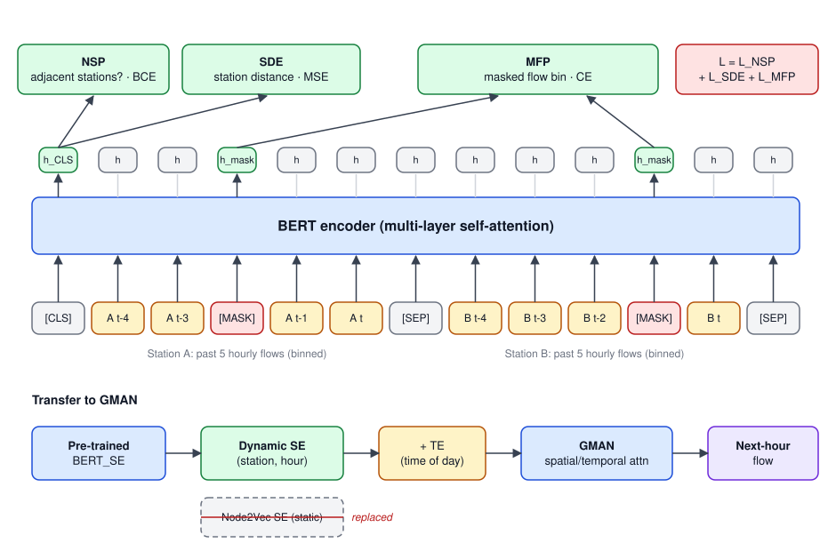
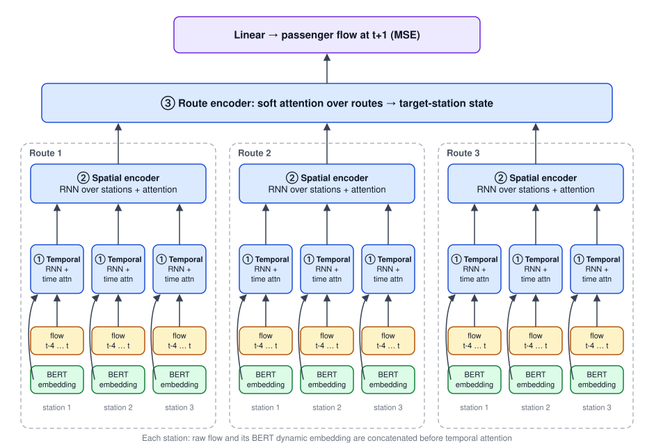

## 論文資訊

| 項目 | 內容 |
|---|---|
| 發表 | Knowledge-Based Systems, Vol. 304, 112442 (2024) |
| 標題 | Dynamic traffic network representation model for improving the prediction performance of passenger flow for mass rapid transit |
| 作者 | Jheng-Long Wu, **Wei-Yi Chung**, Yu-Hsuan Wu, Yen-Nan Ho |
| DOI | [10.1016/j.knosys.2024.112442](https://doi.org/10.1016/j.knosys.2024.112442) |
| 程式碼 | 沒有獨立 repo；預訓練部分沿用 [IIAI-AAI 2021 的 repo](https://github.com/h30306/A-Dynamic-Embedding-Method-for-Passenger-Flow-Estimation) |

這篇是 [A Dynamic Embedding Method for Passenger Flow Estimation]() 的期刊延伸版。我在 2021/06 到 2022/01 之間負責期刊稿的中英文撰寫與實驗，論文在 2024 年正式刊出。以下內容依我手上的投稿稿件整理，最終版本以期刊為準。

## 研究動機

研討會版本證明了動態站點嵌入比靜態嵌入好，但下游模型仍是 GMAN。期刊版想進一步回答：

- 尖峰和離峰的流量差很大，用同一組站點特徵預測會產生偏差，動態特徵能不能在**流量變化大的站點與時間點**上帶來更穩定的預測？
- 捷運站的人流至少來自兩個方向，轉乘站更多；能不能讓模型分開關注**時間、站點、路線**三種面向？

## 模型架構

整體一樣分兩階段：先預訓練 BERT 人流嵌入，再接到三層的階層式注意力模型（HAN）預測人流。

### 第一階段：四個目標的預訓練

輸入格式和研討會版相同：兩個站各取過去 5 小時、分箱後的人流序列，用 `[CLS] … [SEP] … [SEP]` 串接並隨機遮罩（架構見下圖，期刊版把 NSP 換成以下的空間目標）。

期刊版把學習目標擴充成一個主目標加三個輔助目標，讓模型除了數值變化，也學到更多**空間概念**：

| 目標 | 用哪個輸出 | 預測什麼 | 損失 |
|---|---|---|---|
| MFP（主目標） | 被遮住位置的 `h` | 被遮住的人流區間，學尖峰離峰的變化 | Cross-entropy |
| SRP（Same Route Prediction） | `h_CLS` | 兩段序列是否來自同一條路線 | Cross-entropy |
| ASP（Adjacent Station Prediction） | `h_CLS` | 兩段序列是否來自相鄰站 | Cross-entropy |
| SDE（Station Distance Estimation） | `h_CLS` | 兩站直線距離，區分市中心與郊區的站 | MSE |

四個損失相加後一起訓練。

### 第二階段：階層式注意力模型（HAN）

HAN 由下往上分三層，每層負責一個面向：

1. **時間編碼層（Temporal）**：對每個站，把原始人流序列丟進 RNN，再和 BERT 輸出的動態嵌入**串接**，用 soft attention 決定過去每個時間點的重要性，得到這個站的時間狀態。
2. **空間編碼層（Spatial）**：同一條路線上，取目標站附近的幾個站，把它們的時間狀態依站序丟進 RNN（站點在路線上是連續的），再用 soft attention 加權，得到這條路線對目標站的影響。
3. **路線編碼層（Route）**：一個站的人流可能來自好幾條路線（轉乘站更多），每條路線的來源也不同（市區、郊區、住宅區），所以最後用 soft attention 決定每條路線的權重。路線之間沒有順序關係，這層只用 attention、不用 RNN。

最後接一層 Linear 輸出下一個時間點的人流，用 MSE 訓練。

## 結果

- 加入預訓練特徵後，HAN 的預測表現提升，在**高變化量的站點與時間點**特別明顯。
- 投稿稿件中依時段比較 MAE（本文封面圖）：純 HAN 在 08:00 與 17:00–18:00 尖峰的誤差很高，加入 BERT 動態表徵的版本把尖峰誤差壓低了一大截。
- 整體模型在不同人流情境下有較好的泛化性與穩健性。

## 程式碼與資源

- 預訓練 BERT 動態表徵的程式碼在 [IIAI-AAI 2021 repo](https://github.com/h30306/A-Dynamic-Embedding-Method-for-Passenger-Flow-Estimation)。
- HAN 下游模型的程式碼沒有放上 GitHub。
- 本機保留了期刊稿各版本（`交通期刊_Howard_202106xx`–`交通期刊_英文_Howard_20220105`）以及整理過的交通流量預測文獻（EndNote）。
